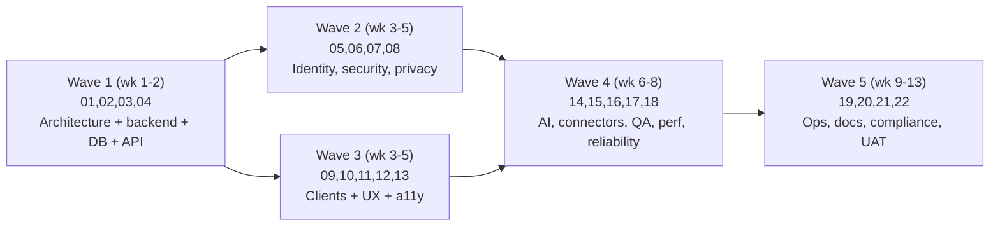

# Independent Assessment — Reviewer Identification & Production-Readiness Audit

**Repository:** `oloyaisaac/intelligent-data-capture-platform` ("IDCP", _AI Universal Data Capture Platform_)
**Branch assessed:** `arena/bc459461-intelligent-data-capture-platf` @ `43d384b`
**Assessment date:** 2026-11-15
**Assessment type:** read-only static + runtime inspection. **No source file was modified.**
**Deliverable of this phase:** reviewer register, feature matrix, test plan, risk register, release gates.

---

## 0. Assessment basis — what was actually done

Rule 14 of the brief forbids modifying the repository during assessment. That was honoured: `git status --porcelain` returned empty after all work. The only file added is this report.

### 0.1 Commands executed (reproducible)

| Step             | Command                                                     | Result                                                       |
| ---------------- | ----------------------------------------------------------- | ------------------------------------------------------------ |
| Install          | `npm ci --no-audit --no-fund`                               | 940 packages, exit 0                                         |
| Full gate        | `npm run verify`                                            | **exit 0**, 30 suites, **406 tests passed**, 44.8 s          |
| Coverage         | `npx jest --coverage --coverageReporters=text-summary`      | stmts 74.47%, **branches 58.75%**, funcs 66.2%, lines 76.88% |
| Dependency audit | `npm audit --json`                                          | **23 advisories** (1 critical, 5 high, 10 moderate, 7 low)   |
| Prod-only audit  | `npm audit --omit=dev`                                      | **8 advisories** (1 critical, 5 high, 2 moderate)            |
| Renderer build   | `npm run build --workspace @idcp/desktop`                   | exit 0, bundle 526.06 kB, **no backend URL baked in**        |
| Structure        | `git ls-files`, LOC per workspace, route/table/index counts | see §1                                                       |

### 0.2 Claims in the repository's own documentation — verified or refuted

| Claim (source)                                                                 | Verified?                                                  | Evidence                                                                                                               |
| ------------------------------------------------------------------------------ | ---------------------------------------------------------- | ---------------------------------------------------------------------------------------------------------------------- |
| "406 tests in 30 suites" (README, AGENT_STATE)                                 | **True**                                                   | `npm run verify` output                                                                                                |
| "all 45 planned stories are built" (README, PRD.json)                          | **True as a status field, misleading as a quality signal** | 45/45 `done`, but 11 stories carry a `verification` block naming criteria that are _asserted rather than demonstrated_ |
| "`npm run verify` is the same command CI runs" (README)                        | **True**                                                   | `.github/workflows/ci.yml`                                                                                             |
| "9 advisories (1 critical)" (AGENT_STATE.md §Ops-4)                            | **False — stale**                                          | Actual: 23 total / 8 in production tree. `zod` is a **direct production dependency** (not merely transitive)           |
| "Every button, link and menu entry does something" (AUDIT-2026-10 §1.1)        | **Not verifiable in this environment**                     | No browser/Electron runtime; no e2e tooling exists (§10 R-13)                                                          |
| ARCHITECTURE.md §8: "No application code, so none of the above is implemented" | **False — stale**                                          | 41,288 lines of tracked application code                                                                               |
| "API_BASE_URL baked per build environment" (DEPLOYMENT.md line 104)            | **False**                                                  | No build-time injection exists; see R-01                                                                               |
| Desktop reaches API through the dev-server proxy (vite.config.ts)              | **True in dev only**                                       | Proxy is `server`/`preview` config; absent from `build`                                                                |

### 0.3 Cannot be verified in this environment (Rule 11 disclosure)

These gaps are **not** findings against the code; they are boundaries of this assessment and must be closed by named reviewers with the stated infrastructure.

| Unverifiable here                                                   | Missing prerequisite                                   | Consequence                                                                              |
| ------------------------------------------------------------------- | ------------------------------------------------------ | ---------------------------------------------------------------------------------------- |
| PostgreSQL code path (`pg` driver, migrations, `$1` rewriting)      | no PostgreSQL server                                   | Production DB path is **typechecked, never executed**                                    |
| MySQL, PostgreSQL, Google Sheets connectors                         | no live servers / OAuth client                         | Integration correctness unproven                                                         |
| HubSpot, Odoo, QuickBooks connectors                                | no tenant accounts / sandbox credentials               | Same                                                                                     |
| Electron shell behaviour (IPC, `file://`, keychain, CSP in situ)    | no Electron binary / display                           | Shell tested only against a hand-written stand-in (`test/shell.test.ts`)                 |
| Signed installers, notarisation, auto-update                        | no signing certificates                                | DESK-001 verification block open                                                         |
| React Native native build (camera, VisionCamera worklets, keychain) | no Android SDK / Xcode                                 | Mobile is JS-tested only                                                                 |
| Local OCR (`tesseract` binary)                                      | **binary absent** (`command -v tesseract` → not found) | The advertised default AI path cannot run here; fails with an actionable error by design |
| Speech (voice commands, TTS)                                        | native modules not installed                           | VOICE-001 degrades to button-only                                                        |
| Mail delivery (password reset, invitations)                         | **no transport exists in repo**                        | See R-02 — a functional blocker, not merely unverifiable                                 |
| Load / soak behaviour                                               | no load-test tooling                                   | Performance targets are asserted, not measured                                           |
| Publish pipeline                                                    | no `Dockerfile`, CI stops at renderer build            | Deployability unproven                                                                   |

**Assessment honesty statement:** a green `npm run verify` proves the code typechecks, lints and satisfies 406 written assertions. It does **not** prove the product installs, reaches its own API, sends a password-reset link, or survives a PostgreSQL restart. §10 records what a passing suite is currently unable to catch.

---

## SECTION 1 — Project name and repository overview

### 1.1 What the product is

A three-platform, multi-tenant SaaS for converting photographed business documents (receipts, invoices, delivery notes, IDs, contracts) into structured records that are reviewed by a human and pushed into external business systems (spreadsheets, SQL databases, CRM/ERP).

Core loop: **phone captures → AI extracts → human confirms uncertain fields → record is exported or pushed to a destination.**

### 1.2 Measured size

| Workspace             | Files            | LOC         | Role                                                                                              |
| --------------------- | ---------------- | ----------- | ------------------------------------------------------------------------------------------------- |
| `apps/backend`        | 66 src + 26 test | **18,451**  | Fastify 5 HTTP API, in-process job worker, migrations, AI pipeline, connectors host, realtime hub |
| `apps/desktop`        | 30 src + 3 test  | **10,008**  | Electron shell + React 19/Vite 6 renderer (12 pages)                                              |
| `apps/mobile`         | 26 src + 1 test  | **5,029**   | React Native 0.86 capture/pairing/queue app                                                       |
| `packages/connectors` | 14               | **2,936**   | Connector SDK + 8 first-party connectors                                                          |
| `packages/shared`     | 13               | **4,864**   | UDM + Zod contracts, i18n (2,105 LOC), money/dates/CSV/dedupe                                     |
| `scripts/`            | 5                | 754         | PRD / OpenAPI / packaging / legal contract validators                                             |
| `docs/`               | 3                | 2,263       | OpenAPI 3 document, two JSON Schemas                                                              |
| `legal/`              | 6                | 496         | Privacy, Terms, DPA, sub-processors, security summary                                             |
| **Total tracked**     | **245**          | **≈41,300** |                                                                                                   |

Structural counters (all measured):

- **101** HTTP route registrations; **102** OpenAPI operations; **85** documented paths.
- **32** tables, **29** indexes, one hand-written forward-only migration set.
- **5** roles: `owner`, `admin`, `reviewer`, `operator`, `viewer`.
- **8** connector implementations (CSV, SQLite, PostgreSQL, MySQL, Google Sheets, HubSpot, Odoo, QuickBooks).
- **45** PRD stories, all `done`; **15** epics; **4** open product questions (`Q-001`..`Q-004`).
- **647** i18n keys × 3 locales (`en`, `sw`, `fr`).

### 1.3 Architecture as built

```
React Native app ──QR pair/HTTPS──┐
                                  ├──► Backend (single process)
Electron renderer ──HTTPS/SSE─────┘        │
                                           ├─► SQLite (node:sqlite) | PostgreSQL (pg)
                                           ├─► Filesystem storage (STORAGE_PATH)
                                           ├─► AI: tesseract subprocess | cloud HTTP (opt-in)
                                           └─► 8 connectors ─► external business systems
```

Layering is consistently `http/routes → services → repositories → db`. Pure logic (workflow engine, marketplace catalogue, edge detection, CSV, dedupe, money) sits beside its feature and is directly unit-testable. Cross-app code lives in `packages/`; no `apps/*` → `apps/*` imports were found.

### 1.4 Documentation inventory

17 root documents (README, ARCHITECTURE, API, DATABASE, SECURITY, TESTING, DEPLOYMENT, ENVIRONMENT, DECISIONS, CHANGELOG, REQUIREMENTS, PRD.json, AGENT_STATE, TASKS, CONTRIBUTING, AUDIT-2026-10, AI.md) plus `legal/` and `docs/`. Documentation volume is unusually high for the code volume — which is both a strength (handover discipline) and a risk (documents have already drifted from code: §0.2).

---

## SECTION 2 — Technology stack

| Layer             | Technology                                     | Version (lockfile)                        | Assessment note                                                         |
| ----------------- | ---------------------------------------------- | ----------------------------------------- | ----------------------------------------------------------------------- |
| Runtime           | Node.js                                        | 22.22.3 (`.nvmrc` = 22)                   | `node:sqlite` is flagged **experimental** at runtime in the test output |
| Language          | TypeScript                                     | 5.7 strict                                | `tsc --noEmit` clean across 5 workspaces                                |
| Monorepo          | npm workspaces                                 | npm 10.9.8                                | lockfile present, `npm ci` reproducible                                 |
| Backend framework | Fastify                                        | 5.x                                       | plus `@fastify/multipart`, `cors`, `rate-limit`                         |
| Validation        | zod                                            | **3.24 (direct prod dep, high advisory)** | See R-05                                                                |
| Auth crypto       | `@node-rs/argon2`, `jsonwebtoken` HS256        | Argon2id m=65536, t=3, p=1                | OWASP-parameter passwords                                               |
| DB drivers        | `node:sqlite`; `pg` 8.13                       | 2 drivers, 1 migration set                | Portability is the unresolved risk (§10 R-04)                           |
| Desktop           | Electron + React 19 + Vite 6                   | `contextIsolation: true`, `sandbox: true` | `electron-builder` targets Win/macOS/Linux                              |
| Mobile            | React Native 0.86, React Navigation 7          | JS-only in this checkout                  | Native modules absent                                                   |
| Realtime          | Server-Sent Events                             | `RealtimeHub` interface                   | Socket.IO adapter unwritten (DEC-016)                                   |
| AI                | `tesseract` CLI subprocess; generic cloud HTTP | local-first                               | Binary is an **external system dependency**                             |
| Spreadsheets      | `exceljs` 4.4                                  | direct prod dep, moderate advisory        |                                                                         |
| Testing           | Jest 29 + ts-jest + jest-environment-jsdom     | 5 projects                                | **No Playwright/Detox/Maestro anywhere**                                |
| CI                | GitHub Actions                                 | 2 jobs (`verify`, secret scan)            | No build/publish/deploy/audit-gate                                      |
| Legal/compliance  | Markdown published via `GET /legal/{slug}`     | contract-tested                           | Company identity is placeholder text                                    |

**Platform count: 3** (server, desktop, mobile) — the first major driver of reviewer count.

---

## SECTION 3 — Project complexity classification

### Classification: **D — Complex application**, at the lower edge of **E (Enterprise-level)**

**Not F (mission-critical):** no real-time safety, financial settlement, or life-critical function. A failure costs a customer a lost afternoon and possibly a retyped document, not injury or money movement (there is no payment rail in the code).

**Not C (medium):** the objective indicators are all well above medium.

| Complexity driver             | Measured                                                                                                                                                                           | Weight                                      |
| ----------------------------- | ---------------------------------------------------------------------------------------------------------------------------------------------------------------------------------- | ------------------------------------------- |
| Application platforms         | **3** (API/worker, Electron, React Native) + 8 outbound connector families                                                                                                         | High                                        |
| Code volume                   | ≈41,300 LOC of first-party TS/TSX                                                                                                                                                  | High                                        |
| User roles & permission model | **5** roles × tenant scoping on 32 tables                                                                                                                                          | High                                        |
| External integrations         | **8** connectors, 3 CRM/ERP, 2 SQL engines, 2 spreadsheet/file, 1 OAuth-dependent                                                                                                  | Very high                                   |
| Persistence complexity        | 2 database engines under one migration set; jobs table with transactional claim, backoff, dead-letter, stale-claim requeue                                                         | High                                        |
| Security requirements         | multi-tenant isolation, 3 credential types, MFA, envelope encryption, audit trail, DSAR export/erasure                                                                             | Very high                                   |
| Business-logic complexity     | UDM normalisation, per-field confidence thresholds, mapping transforms, duplicate policy (`skip`/`update`/`merge`/`append`), workflow engine with approvals, batch partial failure | High                                        |
| AI surface                    | OCR + classification + extraction + confidence, with a provider abstraction and cost caps                                                                                          | High (inherently non-deterministic)         |
| Regulatory exposure           | personal data, ID documents, **Uganda DPPA 2019** + GDPR-shaped DPA, retention periods                                                                                             | High                                        |
| Deployment complexity         | 3 desktop OS targets + 2 mobile OSes + server + filesystem storage that must be restored with the DB                                                                               | High                                        |
| Financial/operational risk    | **no payment processing** (a `plan` column and nothing else)                                                                                                                       | Low                                         |
| Automated test base           | 406 tests, 74% statements but **59% branches**, **zero e2e**                                                                                                                       | Medium (a _risk_ driver, not a size driver) |

**Why not Enterprise (E) in full:** there is no SSO/SAML, no billing, no SOC 2 / ISO 27001 posture, no penetration test on record, no multi-region deployment, and the shipped runtime is deliberately a **single process** (DEC-029). A buyer's procurement review would classify it as "enterprise-intended, pre-enterprise-evidence".

**Why the classification matters for reviewer count:** the three independent platforms alone justify three separate engineering reviewers; the 5-role multi-tenant model justifies separating authentication from authorisation; the AI pipeline and the 8 connectors are each large enough that neither can be folded into a generic backend review; the privacy/legal obligations add two non-engineering reviewers.

---

## SECTION 4 — Total number of required reviewers

# **22 independent specialist reviewers**

Organised into **7 boards**, executing in **5 waves** (§12).

| Board | Focus                                | Reviewers |
| ----- | ------------------------------------ | --------- |
| **A** | Architecture & core domain           | 01–04     |
| **B** | Identity, security & privacy         | 05–08     |
| **C** | Client platforms & experience        | 09–13     |
| **D** | AI & integrations                    | 14–15     |
| **E** | Quality, performance & reliability   | 16–18     |
| **F** | Operations, delivery & documentation | 19–20     |
| **G** | Business, legal & acceptance         | 21–22     |

### 4.1 Why exactly 22 — the derivation

**Earned by platform:** 3 platforms ⇒ 3 engineering reviewers (09 desktop renderer, 10 desktop platform/packaging, 11 mobile). The renderer and the Electron shell are different skills against different threat models; the mobile app shares almost no code with either.

**Earned by security criticality:** the brief permits two reviewers on one feature from different perspectives. Three do so here, deliberately:

- **05 (Authentication)** — credential _strength and lifecycle_: Argon2id parameters, token rotation, TOTP, recovery codes, reset flow.
- **06 (Authorisation & tenancy)** — _who may do what to whose row_: 5-role RBAC, `organisation_id` scoping across 32 tables, IDOR, 404-not-403 disclosure policy.
- **07 (Application Security)** — the _attacker's_ view: upload sniffing bypass, path traversal, SSRF via user-supplied connector endpoints, Electron hardening, dependency exploitability, applied cryptography.

Each examines authentication or tenant data, but their **failure criteria are disjoint**: 05 fails if a hash is weak; 06 fails if another tenant's row is reachable; 07 fails if an attacker can reach it without credentials at all.

**Earned by integration surface:** 8 connectors against real business systems ⇒ **15**. The AI pipeline (non-deterministic, PII-bearing, externally billed) cannot be reviewed by the connector specialist ⇒ **14**.

**Earned by measured quality gaps:** the suite has 59% branch coverage and no e2e ⇒ **16 (QA/test architecture)**. No load test exists and two performance claims are "asserted by design" ⇒ **17**. No `/metrics`, no alerting, and failure recovery exists but is unexercised in production ⇒ **18**. These are three different bodies of evidence, not one.

**Earned by the deployment record:** no `Dockerfile`, no publish step, no backup/restore, no audit gate ⇒ **19 (DevOps)**. The documentation has already drifted from the code in at least four places ⇒ **20 (release/documentation traceability)**.

**Earned by the regulatory and commercial record:** personal data + Uganda DPPA + DPA/terms with **placeholder company details** ⇒ **21 (compliance/legal-technical)**. The product cannot currently deliver a password-reset email, sells no plan, and ships no signed installer ⇒ **22 (UAT & commercial readiness)**.

**Earned by the human-in-the-loop premise:** the product's entire differentiator is a review screen ⇒ **12 (UX)** and **13 (accessibility & i18n)**. 19 `aria-*` attributes across 12 pages is thin evidence for a WCAG claim.

### 4.2 Reviewers deliberately **excluded** (and why omitting them is correct)

| Excluded specialist                               | Why not needed                                                                                                                                                                                                                              |
| ------------------------------------------------- | ------------------------------------------------------------------------------------------------------------------------------------------------------------------------------------------------------------------------------------------- |
| Payment processing / PCI-DSS                      | **No billing integration exists.** `grep` for `stripe                                                                                                                                                                                       | paypal | billing | checkout | subscription`across`apps/`and`packages/`returns only an`invoices`document type and a`payment=()`CSP directive.`organisations.plan`defaults to`'free'` and is never charged. |
| Fraud prevention / AML                            | No financial transactions, no funds movement, no KYC.                                                                                                                                                                                       |
| Financial systems / accounting correctness        | No ledger, no rounding-to-money movement, no tax computation. `money.ts` (101 LOC) is a _parsing/formatting_ helper for extracted values — folded into **03**.                                                                              |
| Mobile _native_ (Swift/Kotlin) engineer           | No native source in the tree; the app is JS/TS over prebuilt RN modules. Native build risk is a **packaging** concern assigned to **11** + **19**.                                                                                          |
| Cloud architect as a separate head                | The shipped runtime is one process with a filesystem (`STORAGE_DRIVER=s3` **fails fast by design**). AWS/GCP architecture review would examine infrastructure that does not exist; **19** covers what is deployable.                        |
| Data-science/modelling specialist                 | There is no model training or evaluation corpus. The AI reviewer (**14**) audits a _pipeline and provider abstraction_, and must record that `AI-002`'s "agreed benchmark on a labelled test set" **has no test set anywhere in the repo**. |
| Penetration tester as a separate head from AppSec | AppSec (**07**) includes offensive testing. Splitting them would duplicate the same attack surface. External pen-test remains a _procurement artefact_ → **21**.                                                                            |
| Hardware/embedded, blockchain, game engine, HPC   | Not present.                                                                                                                                                                                                                                |

**Total: 22 reviewers, 0 duplicates, 7 deliberately excluded.** The number is derived from measured surface area, not chosen in advance.

---

## SECTION 5 & 6 — Complete reviewer register with responsibilities and criteria

Format per reviewer: **Expertise · Files/components · Features · Technical criteria · Security considerations · Tests to perform · Expected evidence · Passing conditions.**

---

### WAVE 1 — Foundations (must pass before Waves 2–3 begin)

## REVIEWER 01: SOFTWARE ARCHITECT

**Required expertise:** layered/hexagonal architecture, modular monolith design, multi-tenant SaaS patterns, TypeScript monorepo governance.

**Exact files/components to examine:**
`ARCHITECTURE.md`, `DECISIONS.md`, `packages/shared/src/contracts.ts`, `packages/shared/src/index.ts`, `apps/backend/src/http/app.ts`, `apps/backend/src/services/container.ts` (dependency wiring), `apps/backend/src/index.ts`, every `src/services/*.ts` constructor, `apps/backend/package.json` + `packages/*/package.json` (workspace boundaries), `tsconfig.base.json`.

**Features to investigate:** layering discipline; dependency-injection container; single-process runtime (DEC-029); shared-package contracts; separation of API role vs worker role; realtime transport abstraction.

**Technical criteria to evaluate:**

1. Does any `repositories/*` file contain business rules, or any `routes/*` file contain SQL? (measured: SQL is confined to `repositories/` — verify it stays so)
2. Does `packages/shared` depend on any `apps/*`? (must not)
3. Is the worker truly idempotent and safe if a second worker is started?
4. Are all cross-cutting concerns (auth, error envelope, logging, request id) applied once rather than per-route?
5. Is the **documentation-vs-code drift** structural? Specifically: `ARCHITECTURE.md` §8 still says "No application code… none of the above is implemented"; §6 "target layout" contradicts the shipped tree; it cites `prisma/` which does not exist.
6. Is `container.ts` a composition root or a service locator (testability, hidden coupling)?

**Security considerations:** if the container is the only place secrets are injected, confirm no service reads `process.env` directly (config.ts is the sole reader — verify by grep).

**Tests to perform:** import-graph analysis across workspaces; a "second worker" experiment (`WORKER_ENABLED=true` twice on one DB); `grep -rn "process.env" apps/backend/src`; `grep -rn "db\.\|SELECT\|INSERT" apps/backend/src/http`, expecting only orchestration.

**Expected evidence:** import graph artefact; list of layering violations with file:line; drift list where `ARCHITECTURE.md` disagrees with the tree.

**Passing conditions:** no inverted dependencies; no SQL outside repositories; no `process.env` outside `config.ts`; `ARCHITECTURE.md` corrected to describe the shipped system (its §8 "Known gaps" is factually wrong today); documented single-process constraint with an explicit, tested scale-out path.

---

## REVIEWER 02: BACKEND ENGINEER (HTTP API & domain services)

**Required expertise:** Fastify 5 plugin lifecycle, schema validation, REST resource design, idempotency, transactional service design.

**Exact files/components to examine:** all 16 files in `apps/backend/src/http/routes/`; `http/app.ts` (error handler, headers, access log, plugin registration); `services/{auth,document,review,export,batch,project,template,connector,workflow,organisation,privacy,marketplace,pairing,api-key,maintenance,worker}-service.ts`; `docs/openapi.yaml`; `test/helpers.ts`.

**Features to investigate:** 101 registered routes; request validation via zod; idempotent upload (`Idempotency-Key`); multipart limits; PDF/CSV export; batch partial-failure; pagination/cursors; error envelope consistency; 404-vs-403 disclosure.

**Technical criteria to evaluate:**

1. Every mutating route validates its body with a shared zod schema — list any that read `request.body as X` without `safeParse`.
2. Idempotency: does a retried upload with the same key return the _same_ document id, and is the key scoped per organisation?
3. Is pagination bounded (`limit` clamped server-side)? (measured: `Math.min(limit,100)` and `10_000` — verify no unbounded query)
4. Is the error handler masking internals on 500? (measured `toErrorEnvelope` masks unknown errors — confirm no route bypasses it)
5. Does `app.ts` register routes under `/api/v1` once, and is there any un-prefixed route?
6. Are route handlers free of `await` inside loops over unbounded collections?

**Security considerations:** route-level authorisation is delegated to `guards.requireRole` — enumerate which privileged routes (`api-key`, `organisation`, `connector`, retention) lack it. Confirm `GET /legal/{slug}` remains allow-listed.

**Tests to perform:** contract diff `docs/openapi.yaml` (102 ops) vs `grep` of route registrations (101) — explain any delta; fuzz every route with `{}`, wrong types, oversized strings; replay an upload with a reused idempotency key; send malformed JSON, wrong content-type, truncated multipart.

**Expected evidence:** route→validation→auth matrix (101 rows); OpenAPI delta report; idempotency replay transcript; fuzz results.

**Passing conditions:** 100% of routes validated and authorised or explicitly public; OpenAPI matches the code exactly; no unbounded query; error envelope identical in shape for all failures.

---

## REVIEWER 03: DATABASE ENGINEER / DATA-INTEGRITY SPECIALIST

**Required expertise:** relational modelling, SQLite _and_ PostgreSQL semantics, migration safety, transaction isolation, indexing, data lifecycle (retention, soft delete, erasure).

**Exact files/components to examine:** `apps/backend/src/db/{migrations.ts (528 LOC, 32 tables, 29 indexes), database.ts, sqlite.ts, postgres.ts, migrate-cli.ts, seed-cli.ts, index.ts}`, `apps/backend/src/repositories/*.ts` (13 files), `DATABASE.md`, `test/worker-recovery.test.ts`.

**Features to investigate:** schema; two-driver portability; job claim/backoff/dead-letter; stale-claim requeue (`RECOVERY_GRACE_MS`); soft delete; retention purge; DSAR erasure; audit-log immutability; batch items.

**Technical criteria to evaluate:**

1. **Portability (highest-value question).** `migrations.ts` is SQLite-flavoured. `DATABASE.md`/DEC-013 claim `pg` is the production path. Enumerate every construct that is not valid PostgreSQL (INTEGER-as-boolean, `INSERT OR IGNORE`, `ON CONFLICT` variants, `datetime()`, `PRAGMA`, `AUTOINCREMENT`, backtick quoting) and state whether `DB_DRIVER=postgres` can apply migrations at all. **This is expected to be the single largest unverified risk in the project.**
2. Is the `?`→`$1` rewrite in `toPostgresPlaceholders` safe for literal `?` inside strings/JSON payloads?
3. Are multi-write operations wrapped in `db.transaction`? List any that are not (document + job + audit must be atomic).
4. Does `softDelete` correctly prevent double-delete, and does every read path exclude `deleted_at`?
5. Is erasure (`/me/erase`) complete across all 32 tables, or can orphan PII survive in `audit_logs`, `batch_items`, `extractions`?
6. Are there indexes for the hot paths: `documents(organisation_id, created_at)`, `jobs(status, run_after)`, `sessions(refresh_token_hash)`, `audit_logs(organisation_id, created_at)`?
7. Does `VACUUM`/retention purge orphan storage objects (files left on disk after row deletion)?

**Security considerations:** is any connection string or PII written to logs? Are `audit_logs` append-only by construction (no UPDATE/DELETE route)?

**Tests to perform:** run the migration set against a real PostgreSQL 16 (`DB_DRIVER=postgres`); seed; execute the full backend suite against Postgres; concurrent job-claim race with two processes; kill mid-transaction; retention purge then verify storage is empty; erase a user then `SELECT` across all 32 tables for residual PII.

**Expected evidence:** migration transcript on Postgres (pass/fail per statement); orphan-row and orphan-file queries; EXPLAIN plans for the 6 hot queries; transaction-atomicity inventory.

**Passing conditions:** migrations apply cleanly on PostgreSQL **or** the claim is withdrawn and DEC-013 rewritten to state SQLite-only; all multi-write flows atomic; zero orphan rows/files after retention and erasure; hot paths indexed; `DATABASE.md` matches the code (it has been wrong before — see the TASKS.md note that it once claimed the schema was unimplemented).

---

## REVIEWER 04: API & CONTRACT ENGINEER

**Required expertise:** OpenAPI 3 authoring, backward compatibility, versioning, developer-facing API design, contract testing.

**Exact files/components to examine:** `docs/openapi.yaml` (85 paths / 102 ops), `scripts/validate-openapi.mjs`, `docs/udm-1.0.schema.json`, `docs/prd.schema.json`, `packages/shared/src/contracts.ts` (966 LOC), `packages/shared/src/udm/schema.ts`, `scripts/generate-udm-schema.mjs`, `apps/backend/src/http/routes/api-key-routes.ts`, `packages/connectors/src/contract.ts`.

**Features to investigate:** the public/developer API (DEVAPI-001); API-key scopes; UDM versioning; the OpenAPI↔route contract validator; error envelope stability.

**Technical criteria to evaluate:**

1. Does `validate-openapi.mjs` compare _operations_ or only paths? Can a handler change its response shape without CI failing?
2. Are API keys scoped (read/write/which resources) or all-or-nothing? Can an API key created for export also delete documents?
3. Is the UDM versioned with an explicit compatibility policy? Does `udm-1.0.schema.json` match `udm/schema.ts` (the generator has a `--check` mode in CI — verify it cannot pass while drifting)?
4. Are pagination, rate-limit headers and error codes documented per operation?
5. Is there any deprecation/versioning policy for `/api/v1`?

**Security considerations:** API keys must be hashed at rest (verify `apikey-repo`), revocable, and must not inherit a human's full role by default.

**Tests to perform:** mutate a response field in a route and confirm CI fails; enumerate API-key capability surface by test; validate the generated JSON Schema against a corpus of stored UDMs; check that removed fields are treated as breaking.

**Expected evidence:** contract-coverage table (route → documented request → documented responses); scope matrix for API keys; schema-drift demonstration.

**Passing conditions:** every operation documented with request, all responses and error codes; contract test fails on behavioural drift, not just route removal; API keys least-privilege and hashed; versioning policy written.

---

### WAVE 2 — Identity, security and privacy (gate the closed beta)

## REVIEWER 05: AUTHENTICATION ENGINEER

**Required expertise:** password hashing (Argon2id), JWT lifecycle, refresh-token rotation, TOTP/RFC 6238, OWASP ASVS v4 (V2/V3), account-recovery threat models.

**Exact files/components to examine:** `apps/backend/src/auth/{password.ts, tokens.ts, totp.ts}`; `services/auth-service.ts` (**903 LOC — the largest service; read it line by line**); `repositories/auth-repo.ts` (477 LOC); `http/routes/auth-routes.ts` (257 LOC); `test/{auth, auth-recovery, mfa, totp}.test.ts`; `DECISIONS.md` DEC-030, DEC-034; desktop `pages/{LoginPage,AccountPage}.tsx`; mobile `screens/SignInScreen.tsx`.

**Features to investigate:** registration + terms acceptance; login; Argon2id parameters; ≤15 min access JWT; rotating single-use refresh tokens; device credentials; MFA enrolment/verify/disable; 10 hashed single-use recovery codes; forgot/reset password; change password; session list/revoke; logout-all; `AttemptLimiter`.

**Technical criteria to evaluate:**

1. `signAccessToken` uses **HS256** with the same `secret` that — check — also signs the MFA challenge and (see `crypto.ts`) derives the credential-encryption key. **Key reuse across purposes is a finding.** Confirm whether a dedicated MFA audience/issuer is sufficient or whether a separate secret is required.
2. Refresh rotation: is the _used_ token invalidated atomically? Is there reuse-detection (a stolen-then-replayed refresh token should kill the family)?
3. `validatePasswordStrength` rejects 7 hardcoded weak passwords and length <12. Is there any breach-list check? (documented as follow-up — quantify the gap, don't assume)
4. TOTP: is the window ±1 step? Are recovery codes consumed atomically and compared in constant time? Is the TOTP secret encrypted at rest with `SecretBox`?
5. MFA challenge JWT TTL is 300 s — can it be replayed for a different account or after password change?
6. Password reset: single-use, hashed, TTL 1 h, and **no user enumeration** (must always return 202).
7. `AttemptLimiter` is **in-process memory** — document the exact bypass (restart, second replica) and confirm per-account limits back it up.
8. Is `JWT_SECRET` length enforced in production (≥32) and is the development default blocked? (measured: yes — verify tests)

**Security considerations:** no password, TOTP secret or recovery code in logs; constant-time comparison; MFA disable requires password **and** code (verify); session revocation effective immediately for access tokens (note: JWT is stateless — quantify the ≤15 min residual window).

**Tests to perform:** replay a refresh token twice; reuse a recovery code; brute-force login 6× (expect 429/RATE_LIMITED); reset-token replay; enrol MFA, disable, verify neither factor alone works; tamper a JWT `alg`/`role`/`org` claim; clock-skew TOTP boundary test; enumerate users via login and reset responses.

**Expected evidence:** token-lifecycle diagram _as implemented_; per-threat test transcripts; list of secrets and where each is derived from.

**Passing conditions:** single-use rotation proven by test; no enumeration; MFA disable requires both factors; separate key material per purpose (or documented, reviewed justification); no credential material in logs; every claim in `AUDIT-2026-10.md` §4.1 re-verified rather than trusted.

---

## REVIEWER 06: AUTHORISATION & MULTI-TENANCY ENGINEER

**Required expertise:** RBAC/ABAC, tenant isolation, IDOR, row-level scoping, privilege escalation, confused-deputy problems.

**Exact files/components to examine:** `apps/backend/src/http/guards.ts`; `packages/shared/src/constants.ts` (`ROLES`, `roleAtLeast`); **all 13** `repositories/*.ts`; `services/organisation-service.ts`, `services/api-key-service.ts`, `services/pairing-service.ts`; `http/routes/organisation-routes.ts`, `api-key-routes.ts`, `connector-routes.ts`; `test/{security,teams,privacy}.test.ts`.

**Features to investigate:** 5 roles (owner/admin/reviewer/operator/viewer); every repository query's `organisation_id` filter; device-credential actor; API-key actor; invitation flow; role change; cross-tenant reads; the 404-not-403 policy.

**Technical criteria to evaluate:**

1. Build a **complete matrix**: 32 tables × 5 roles × 4 actors (user / device / api_key / public). Every cell must be justified.
2. `guards.authenticate` re-reads `memberships` on every request and **ignores** the `org`/`role` claims in the JWT — confirm this is true for _all_ paths (it is in `guards.ts`; verify no route trusts claims directly).
3. Role change: does demoting `admin`→`viewer` take effect on the _next_ request, or only after token expiry? (code suggests next request — prove it)
4. Device credential: a device acts as its owner. If the owner is removed from the org, is the device immediately dead?
5. API key: does it carry a role? Can it exceed the creating user's role?
6. Enumerate every repository method and check for a missing `organisation_id` predicate. Note the legitimate exceptions (`id`-only lookups used _after_ an org-scoped fetch, e.g. `updateStatus`, `softDelete`) and prove each caller validates ownership first.
7. Is there any route where `requireRole` is absent but should be present — especially `POST /organisation/retention`, connector credential writes, API-key creation, and device revocation?

**Security considerations:** mass-assignment (can a body field raise your own role or plan?); invitation single-use/hash/expiry; `TRUST_PROXY` and `X-Forwarded-For` spoofing effect on per-IP limits.

**Tests to perform:** two organisations, two users; attempt every cross-tenant read/write/delete for every resource type (documents, reviews, exports, connectors, templates, workflows, batches, projects, devices, api-keys, audit-logs, extractions); privilege-escalation attempts from `viewer` and `operator`; revoked-device replay; shared-invite double-use.

**Expected evidence:** the role×resource×actor matrix; a cross-tenant attack suite with pass/fail per cell; grep output of every repository method naming its scoping predicate.

**Passing conditions:** zero cross-tenant data access; zero privilege escalation; every privileged route role-guarded; matrix complete with no unexplained cell; demotion effective on next request.

---

## REVIEWER 07: APPLICATION SECURITY ENGINEER (includes offensive testing)

**Required expertise:** OWASP Top 10 / ASVS, applied cryptography, file-upload security, SSRF, path traversal, Electron security model, supply-chain risk, offensive tooling.

**Exact files/components to examine:** `apps/backend/src/storage/index.ts` (`assertSafeKey`, `buildStorageKey`); `services/document-service.ts` (sniffing); `services/crypto.ts` (envelope encryption); `http/app.ts` (CSP/headers, CORS, multipart); `http/routes/{legal,realtime,document}-routes.ts`; `packages/connectors/src/**` (outbound HTTP, user-supplied URLs); `apps/desktop/src/main/{electron-main,preload}.ts`, `index.html`, `vite.config.ts`; `.github/workflows/ci.yml` (secret scan); `package-lock.json`.

**Features to investigate:** upload validation; storage path construction; connector credentials at rest; SSRF through connector endpoints; security headers; CSP; Electron isolation; dependency surface; secret hygiene.

**Technical criteria to evaluate — with the findings already established:**

1. **Electron `openExternal` (HIGH).** `electron-main.ts` sets `setWindowOpenHandler(({url}) => { void api.shell.openExternal(url); return {action:'deny'} })` with **no protocol allow-list**. In a packaged app a `file://…`, `smb://`, or other registered-protocol URL opened via `window.open` is handed to the OS. Decide: is this exploitable given `sandbox:true`, `contextIsolation:true` and the strict CSP? Then require a `https:`-only allow-list regardless.
2. **CSP misses production (MEDIUM-HIGH).** The only CSP is the `<meta http-equiv>` in `index.html` with `connect-src 'self' ws:`. In dev the renderer is served by Vite over http and reaches the API through the proxy, so `'self'` works. In a packaged app the origin is `file://` — `connect-src 'self' ws:` will **not** permit an `https://` API origin. Confirm, and note the coupling to R-01. Also **no `frame-ancestors`, no `object-src 'none'`, and no CSP response header on the Electron shell**; `style-src 'unsafe-inline'` is present.
3. **SSRF via connectors (assess).** Connector config accepts user-supplied `connectionString`/endpoint (`mysql://`, `postgres://`, `https://`). A tenant with connector-write rights can make the **server** connect to internal addresses. Require a documented egress policy, private-range block, and per-tenant rate limit.
4. **Upload sniffing (verify).** `sniffMimeType` gates on magic bytes and `LIMITS.allowedUploadMimeTypes`; multipart has `files:1`; truncated uploads fail closed with 413. Attempt polyglot files, PDF-with-JS, SVG/HTML disguised as JPEG, ZIP/HEIC bombs, and 20 MB+ boundary cases.
5. **Storage traversal (verify).** `assertSafeKey` + server-generated `buildStorageKey('org/<uuid>/documents/<uuid>.<ext>')` looks sound; prove no user input reaches a key, and that `extensionForMimeType` cannot emit `..`.
6. **Realtime token in query string (assess).** `eventsUrl()` puts the access token in `?access_token=`. The comment claims the server "never logs it" — verify (`app.ts` access log excludes query strings; confirm no proxy access log in the documented deployment would capture it). Recommend a short-lived single-use stream ticket.
7. **Dependencies (established).** `npm audit` = **23 advisories**; `--omit=dev` = **8** (1 critical, 5 high). Directly production: **`zod` 3.24 high** (every request schema), `exceljs` moderate. Transitively production: `shell-quote` **critical** (via `react-native → react-devtools-core`), `image-size` high, `query-string`/`decode-uri-component` high, `uuid` moderate. **`AUDIT-2026-10.md` §4.2 misclassifies these as "all dev/build"** — correct that; `shell-quote` and `zod` are reachable in shipped dependency trees. Assess exploitability through this product's request path (zod memory exhaustion is bounded by `MAX_REQUEST_MB`/`MAX_UPLOAD_MB` — verify that bound is actually enforced on every body, including JSON).
8. **Credentials at rest.** `crypto.ts` derives an AES-256-GCM key via `scryptSync(secret, 'idcp-connector-credentials', 32)` from the **same secret used for JWT signing**. Per-record IV, org bound as AAD — good. But: no key versioning/rotation path, `scryptSync` on the request path is a CPU hazard, and secret reuse couples "rotate JWT secret" to "all connector credentials become undecryptable" (documented, but by design a fragility).
9. **Headers (verify).** `nosniff`, frame options, referrer policy, CORP/COOP, `permissions-policy` incl. `payment=()` — asserted in `test/web-surface.test.ts`; pick the implementation apart for HSTS (absent? It must be set by the proxy) and for whether CSP is a _header_ or only the renderer meta.
10. **Secrets.** CI scans for `.env`/`.pem`/`.key`; confirm no key material in git history (`git log -p --all -S`, `git rev-list --all | xargs git grep` for known patterns).

**Security considerations:** JWT `alg` confusion (HS256 pinned — good); CSRF exposure given bearer tokens in `Authorization` plus CORS (`CORS_ORIGINS` required in production); brute-force on public `POST /pairing/complete` (has `authLimiter` — verify key derivation uses the _real_ client IP and is not spoofable when `TRUST_PROXY=true`).

**Tests to perform:** the upload polyglot suite; path-traversal attempts on every key-derived endpoint; SSRF probes from connector config; JWT tampering; header assertion against a running server; `npm audit --omit=dev` gate; `gitleaks`/`trufflehog` over full history; Electron: attempt `window.open('file:///etc/passwd')` under the stand-in shell and under a real Electron build.

**Expected evidence:** vulnerability register with severity, reachability and fix; header capture from a live response; zapped-upload logs; audit JSON before/after.

**Passing conditions:** R-01/R-04 in §10 closed or risk-accepted in writing by the owner; no critical/high advisory reachable in the production tree (or a documented, dated exception with compensating control); CSP delivered as a response header in the packaged app; `openExternal` allow-listed; SSRF egress policy documented and enforced; no secret in history.

---

## REVIEWER 08: PRIVACY ENGINEER / DATA-PROTECTION OFFICER

**Required expertise:** GDPR + Uganda Data Protection and Privacy Act 2019, DSAR workflows, retention/purge correctness, PII mapping, DPIA, data minimisation, sub-processor governance.

**Exact files/components to examine:** `services/{privacy-service.ts (240), maintenance-service.ts (195)}`; `http/routes/privacy-routes.ts`; `test/{privacy,maintenance}.test.ts`; `legal/{PRIVACY,DPA,SUBPROCESSORS,SECURITY}.md`; `scripts/validate-legal.mjs`; `config.ts` retention keys; `apps/backend/src/db/migrations.ts` (which columns hold PII); `apps/backend/src/logger.ts` (redaction).

**Features to investigate:** `GET /me/export`; `POST /me/erase`; retention purge; expired-export deletion; session sweep; audit retention (24 months); the legal pack; `TRUST_PROXY`/IP hashing (`hashIp`); cloud-AI opt-in (`learning_opt_in`, `AI_PROVIDER`).

**Technical criteria to evaluate:**

1. Produce a **PII inventory** across 32 tables: user email/name, device names, document images, extracted text, IP hashes, TOTP secrets, audit metadata. Every column must have a lawful basis and a retention period.
2. Is `GET /me/export` _complete_ — does it include documents, extractions, corrections, audit entries, devices — or only the user row? (a partial export is a compliance defect)
3. Is `POST /me/erase` complete and _irreversible_, and does it handle the multi-owner refusal it documents? Does it remove **files on disk**, not only rows? Does it leave `audit_logs` referencing an erased user (legitimate-interest retention) with a documented basis?
4. Retention: does the sweep run when `MAINTENANCE_ENABLED=true` and is it **observable**? (audit finding: "a failed maintenance step is a `warn` line and nothing else")
5. Does the retention figure in `PRIVACY.md` match `config.ts` defaults? (`test:legal` asserts this — verify the assertion is meaningful and fails on drift)
6. Cloud AI: is data leaving the customer's infrastructure opt-in, per-organisation, recorded, and disclosed in `SUBPROCESSORS.md`? Is the sub-processor list consistent with the code?
7. Do logs contain PII? `redact()` covers key names — enumerate the key list and check against what services actually log.
8. Is `hashIp` a salted hash or a bare SHA-256 of the IP (bare = reversible by brute force over the IPv4 space)?

**Security considerations:** erasure must be provable (audit entry) and must not be blockable by a lower role; export must not leak other users' data in the same organisation.

**Tests to perform:** export → assert every expected entity present; erase → then query all 32 tables **and** the storage root for residue; run the maintenance sweep and verify deletion; drift `retention_days` and confirm `test:legal` fails; force a maintenance failure and observe whether anything alerts.

**Expected evidence:** PII inventory table (table.column → category → basis → retention → deletion mechanism); export completeness diff; erase residue report; log sample scan.

**Passing conditions:** complete, tested DSAR export/erase including files; retention enforced _and observable_; no PII in logs; legal pack figures match code; sub-processor list matches reality; DPO sign-off on the PIA.

---

### WAVE 3 — Client platforms and experience

## REVIEWER 09: DESKTOP RENDERER ENGINEER (React/Electron UI)

**Required expertise:** React 19, state/effect correctness, async data fetching, Vite bundling, large-page decomposition, renderer-side security.

**Exact files/components to examine:** `apps/desktop/src/App.tsx` (368), `src/api/client.ts` (**960 — token storage, refresh, error mapping**), all 12 pages (`AccountPage` 506, `ReviewPage` 512, `SettingsPage` 695, `TemplatesPage` 353, `DashboardPage` 320, `LoginPage` 312, `DocumentsPage` 284, `BatchesPage` 255, `MarketplacePage` 235, `ConnectorsPage` 231, `DevicesPage` 168, `ExportsPage` 161, `ProjectsPage` 139), `components/{SendToDestination,ui}.tsx`, `lib/{realtime,review,charts,format,locale,labels,i18n}.ts`, `styles.css` (621), `test/desktop.test.tsx` (1511).

**Features to investigate:** sign-in/register/forgot/reset; dashboard over SSE; documents list + filter; review workflow (side-by-side, low-confidence first, bulk approve); mapping/templates; connectors; exports; devices; settings/retention; account (password, sessions, MFA, export, erase); marketplace; workflows; batches; projects; i18n switch.

**Technical criteria to evaluate:**

1. **The base-URL defect (R-01).** `createClient()` in `App.tsx:134` constructs `new ApiClient({ storage, onSessionExpired })` — **no `baseUrl`** — so `client.ts:154` defaults to `'/api/v1'`. Under `file://` that is not an HTTP origin. Confirm by reading both files and by the built bundle (which contains `api/v1` but **no** absolute backend URL). Also confirm `eventsUrl(accessToken, base='/api/v1')` in `lib/realtime.ts` has the same assumption.
2. Token refresh: is there single-flight refresh (concurrent 401s must not each rotate)? Does `onSessionExpired` fire once and drop to sign-in cleanly?
3. Effect correctness: any missing dependency arrays that cause double-fetch or stale closures (the file has an explicit comment about `tRef` — verify the pattern is applied consistently)?
4. `ReviewPage`/`SettingsPage`/`AccountPage` exceed 500 LOC — is state logic extracted or are there untestable monoliths? Are corrections optimistic or confirmed by the server?
5. Bulk approve: partial failure reporting (the docs claim a "skipped report") — verify.
6. Does the renderer ever hold a token in `localStorage`? (`BridgeTokenStorage` vs `MemoryTokenStorage` — confirm `localStorage` is never used.)
7. Bundle size 526 kB (149 kB gzip) with a Vite warning — is there any code-splitting plan?

**Security considerations:** renderer must not be able to reach Node/fs; `dangerouslySetInnerHTML` must be absent; all user-controlled strings rendered as text; the token must go to the bridge, not the DOM.

**Tests to perform:** mount each page with a stub API and assert the primary control works; force 401 and assert drop-to-login; simulate SSE drop and assert backoff (`lib/realtime.ts` caps at 30 s, 6 retries); keyboard-only pass on the review flow; `grep -rn "dangerouslySetInnerHTML\|localStorage\|sessionStorage"`.

**Expected evidence:** base-URL trace with file:line (confirmed defect); refresh single-flight proof; per-page control inventory with mounted-state evidence; list of components over 400 LOC with a decomposition recommendation.

**Passing conditions:** the renderer can be pointed at a real backend and successfully signs in from a **packaged** build (this requires R-01 fixed); single-flight refresh; no token outside the bridge; no HTML injection sink; every page's primary action covered by a test that would fail if it broke.

---

## REVIEWER 10: DESKTOP PLATFORM / ELECTRON PACKAGING ENGINEER

**Required expertise:** Electron main/preload architecture, IPC allow-listing, `safeStorage`, `electron-builder`, code signing/notarisation, auto-update, OS-specific behaviour (Win/macOS/Linux).

**Exact files/components to examine:** `apps/desktop/src/main/{electron-main.ts (157), preload.ts (62)}`; `electron-builder.json`; `index.html`; `vite.config.ts`; `tsconfig.electron.json`; `scripts/validate-packaging.mjs`; `test/shell.test.ts` (213); `DECISIONS.md` DEC-022.

**Features to investigate:** window creation and `webPreferences`; four IPC channels; keychain token file (`session.bin`, mode 0o600); update check; packaging targets (NSIS/portable/dmg/zip/AppImage/deb, x64+arm64); publish config.

**Technical criteria to evaluate:**

1. **`nodeIntegration:false`, `contextIsolation:true`, `sandbox:true`** — all set. Verify with a real Electron build that the preload actually loads under `sandbox:true` (a sandboxed preload cannot `require` arbitrary modules — check the preload's imports).
2. IPC surface is exactly 4 channels — verify none takes a caller-supplied path, command or URL. `idcp:tokens:write` must accept only the sanitised shape (`sanitiseTokens` clamps to ≤4000 chars, string-only — good).
3. `setWindowOpenHandler` calls `shell.openExternal(url)` **before** `deny` and **without a protocol allow-list** — the highest-severity Electron finding in the tree (shared with Reviewer 07; platform owner is 10).
4. **No `will-navigate` handler.** A renderer that navigates to a remote origin would load it inside the shell with the preload's bridge exposed. Confirm and require a navigation guard.
5. `safeStorage.isEncryptionAvailable()` returning false silently degrades to _no persistence_ — acceptable, but is it surfaced to the user? On Linux without a keyring this is the common path.
6. Update mechanism: `idcp:updates:check` returns a **hardcoded `up_to_date`** and `publish.url` is `https://updates.example.invalid/idcp`. There is **no update mechanism**; verify the UI cannot imply otherwise.
7. Packaging contract (`validate-packaging.mjs`) — what does it actually statically assert? Does it prove a signed installer can be produced?
8. macOS `hardenedRuntime:true` with `gatekeeperAssess:false` and no `entitlements` file — assess what breaks in notarisation (camera/microphone entitlements are not needed here, but `sandbox:true` + hardened runtime may need JIT entitlements).

**Security considerations:** ASAR integrity, code-signing identity, update-signature verification, keychain item accessibility class, crash-report PII.

**Tests to perform:** build and launch on each of the three OSes; exercise all four IPC channels; attempt `window.open('file:///etc/passwd')`, `smb://`, `javascript:`; attempt in-app navigation to an external URL; kill the keyring and verify graceful degradation; verify `session.bin` is encrypted (hexdump).

**Expected evidence:** installer artefacts + SHA-256 per platform; Electron security-checklist result per item; IPC fuzz transcript; hexdump of `session.bin`.

**Passing conditions:** installers produced and smoke-tested on all three OSes (this is the open `DESK-001` verification block); `openExternal` allow-listed; `will-navigate` blocked; update path either implemented with signature verification or removed from the UI and docs; no plaintext token on disk.

---

## REVIEWER 11: MOBILE ENGINEER (React Native)

**Required expertise:** React Native 0.86, React Navigation 7, native module integration (camera, barcode, keychain, filesystem, worklets), offline-first sync, battery/memory constraints.

**Exact files/components to examine:** all 26 files in `apps/mobile/src/`: `capture/{edgeDetection.ts (417), imagePipeline.ts (281), frameProcessor.tsx (98), useDocumentDetector.ts (92), QrScannerView.tsx (100)}`; `state/{uploadQueue.ts (226), queueStorage.ts (102)}`; `api/client.ts (388)`; `assist/{commands,consent,guidance,reviewVoice,speechPlatform}.ts`; `screens/{CaptureScreen (279), ReviewScreen (277), PairingScreen (155), SignInScreen (157), QueueScreen (151)}`; `auth/{secureStore,memoryStore,keys}.ts`; `App.tsx`; `test/mobile.test.ts` (1054); `app.json`, `package.json`.

**Features to investigate:** QR pairing; camera capture with edge detection/crop/deskew/enhance/compress; EXIF orientation; offline queue with retry; upload idempotency; review of simple fields; keychain credential storage; voice guidance (consent-gated).

**Technical criteria to evaluate:**

1. `assertSecureEndpoint` enforces `https://` with a loopback exception (`localhost|127.0.0.1|10.0.2.2`) — confirm the regex cannot be bypassed by `https://evil.com/?x=127.0.0.1` or `https://127.0.0.1.evil.com`.
2. Offline queue: is the queue durable across app kill? Is `uploadQueue` backoff bounded? Can a partial upload duplicate a document (must rely on the API `Idempotency-Key` — verify the key is stable across retries, not regenerated per attempt)?
3. `edgeDetection.ts` (417 LOC, pure) — is it genuinely pure and unit-tested, or does it need a device? (docs claim pure + tested; verify)
4. `frameProcessor.tsx` builds a VisionCamera processor **only when `react-native-worklets-core` is installed** — that dependency is absent, so the overlay is inert here. Confirm the capture path still works and that the user is not told detection is active when it is not.
5. Keychain: `ACCESSIBLE.WHEN_UNLOCKED_THIS_DEVICE_ONLY` is set (good). Is the device credential stored as one JSON blob under a single service — what happens on a partial write (`readAll` → mutate → `writeAll` is a read-modify-write race)?
6. Speech modules absent → `speechPlatform` reports unavailable. Verify no screen blocks on it.
7. Memory: image pipeline on a 48 MP capture — is there downscaling before upload, and is the 20 MB server limit respected client-side?

**Security considerations:** no credential in AsyncStorage/preferences; TLS enforced; certificate-pinning decision documented; screenshots of ID documents in the OS app switcher (a `FLAG_SECURE`/blur equivalent is missing — assess).

**Tests to perform:** real device build (Android + iOS); airplane-mode capture → reconnect → verify single document; kill app mid-upload; scan a malicious QR (URL ≠ pairing payload); low-memory capture; revoke the device server-side and verify the app signs out; keychain read with device locked.

**Expected evidence:** device test matrix (OS version × device); offline-reconnect transcript; queue-durability evidence; QR-rejection evidence.

**Passing conditions:** capture→upload→review works on real hardware; queue duplicate-free across retries; TLS enforced with no bypass; credentials only in keychain; no feature silently claims to work when its native module is absent.

---

## REVIEWER 12: UX / PRODUCT DESIGN REVIEWER

**Required expertise:** interaction design for document-capture workflows, error/empty/loading states, information architecture, workflow efficiency, commercial usability.

**Exact files/components to examine:** `apps/desktop/src/pages/*` (all 12), `components/ui.tsx`, `styles.css`, `App.tsx` (navigation model); `apps/mobile/src/screens/*`; `packages/shared/src/review.ts` and `constants.ts` (confidence thresholds); `PRD.json` user stories; `TESTING.md` journeys.

**Features to investigate:** the end-to-end loop (pair → capture → extract → review → approve → export); low-confidence surfacing; duplicate preview card; bulk approve with skipped report; onboarding/first-run; empty and error states; destructive confirmations.

**Technical criteria to evaluate:**

1. Journey map of the 6-step loop with a click count per step; identify every place a user can reach a dead end.
2. Are low-confidence fields _visually prioritised_ as promised ("low-confidence values surfaced first")? Check `ReviewPage` ordering logic against `review.ts` thresholds.
3. Destructive actions: is erasure guarded by password + typing `DELETE` (server requires both — verify the UI does the same)? Is connector-credential replacement confirmed?
4. Error states: what does the user see on a 401, 429, 503, and a connector failure? Is there an actionable next step in each?
5. Is the "Pair a device" empty state instructive on first run?
6. Consistency of terminology across desktop/mobile/docs (e.g. "destination" vs "connector" vs "integration").
7. Commercial gaps visible in UI: no billing, no SSO, no team management beyond invitations — is anything implied that does not exist?

**Security considerations:** no security-relevant state hidden in a tooltip only; MFA prompts must be unambiguous about which factor is which.

**Tests to perform:** moderated usability run of the full loop with 5 representative operators (data-entry staff); time-to-first-approved-document; error-injection pass (mock 4xx/5xx); heuristic evaluation (Nielsen) per page.

**Expected evidence:** annotated journey map; heuristic findings list; error-state screenshots; measured task time.

**Passing conditions:** the full loop is completable without documentation; no dead ends; every destructive action double-confirmed; every error state has a next step; terminology consistent; nothing in the UI promises an unbuilt capability.

---

## REVIEWER 13: ACCESSIBILITY & INTERNATIONALISATION REVIEWER

**Required expertise:** WCAG 2.2 AA, ARIA authoring practices, keyboard/screen-reader testing, RTL/bidi, i18n/pseudolocalisation, colour contrast.

**Exact files/components to examine:** every `.tsx` in `apps/desktop/src` (**measured: only 19 `aria-*` attributes across 12 pages and 2 components — thin**), `styles.css` (contrast tokens, focus styles), `components/ui.tsx` (modal focus trap?), `lib/{locale,labels,i18n}.ts`, `packages/shared/src/i18n.ts` (**2,105 LOC, 647 keys × en/sw/fr**), mobile `ui/{locale,theme}.ts`, `test/*` (only mobile mentions a11y-adjacent validation).

**Features to investigate:** keyboard navigation; focus management in modals; live-region use for SSE-driven list updates (a dashboard that changes underneath a screen reader is a classic failure); form labelling; contrast on the dark theme (`#0d151d` background); locale switching; `Intl` formatting; logical (RTL) properties.

**Technical criteria to evaluate:**

1. Enumerate interactive elements vs accessible names. Tables, filters, bulk-select checkboxes, chart (only `aria-label`?), pagination.
2. `components/ui.tsx` modal has `role="dialog" aria-modal="true"` — is there a **focus trap**, initial focus, Escape handling and focus restoration? (`ref={ref}` suggests some handling — prove it)
3. SSE updates: is there an `aria-live` region so an operator using a screen reader learns a document arrived?
4. Contrast: compute ratios for muted text on `--surface` tokens; target 4.5:1.
5. `style-src 'unsafe-inline'` + inline styles — any `outline: none` without a replacement focus ring?
6. i18n: verify 647 keys × 3 locales with **zero** missing keys, no hardcoded English strings in components (`grep` for literal prose in JSX), and correct pluralisation (`Intl.PluralRules` vs `{count} files` concatenation).
7. RTL: the docs admit **no RTL catalogue ships**; RTL is "verified by the direction helper and a logical-property test". Confirm `document.dir` is applied and that physical properties (`margin-left`) are not used where logical (`margin-inline-start`) is required — a hero claim resting on a unit test is a gap.
8. Verify the documented claim that the Swahili and French catalogues are complete — sample-translate 20 high-traffic strings with a native speaker.

**Security considerations:** none specific; note that aria-label text must not leak tenant data.

**Tests to perform:** axe-core automated scan per page; keyboard-only traversal of the review flow; NVDA/JAWS on Windows and VoiceOver on macOS; contrast audit; pseudolocale build; 200% zoom / 320 px reflow; locale switch mid-session.

**Expected evidence:** axe report per page; keyboard traversal video/log; contrast table; i18n coverage report; native-speaker review of 20 strings.

**Passing conditions:** WCAG 2.2 AA verified **by test, not by assertion**; zero critical axe violations; full keyboard operability including modals; live regions for SSE; 100% i18n coverage with no hardcoded strings; RTL validated with a real RTL catalogue (or the RTL claim withdrawn).

---

## REVIEWER 14: AI / DOCUMENT-INTELLIGENCE ENGINEER

**Required expertise:** OCR, document layout analysis, classification, information extraction, confidence calibration, prompt/provider abstraction, cost and latency control, evaluation methodology.

**Exact files/components to examine:** `apps/backend/src/ai/{pipeline.ts (156), extract.ts (394), classify.ts (112)}`; `ai/providers/{cloud.ts (124), tesseract.ts (116), types.ts (49)}`; `packages/shared/src/udm/schema.ts`; `packages/shared/src/review.ts`; `services/worker.ts`; `templates` service + repo; `test/{ai,worker-recovery}.test.ts`; `config.ts` AI keys.

**Features to investigate:** the OCR→classify→extract→normalise→score pipeline; provider abstraction (local default vs cloud opt-in); per-field confidence; `needs_review` routing; template-based extraction; correction capture (`REV-002`) and the opt-in training export.

**Technical criteria to evaluate:**

1. **Evaluation is the headline gap.** `AI-002` requires "an agreed benchmark on the labelled test set"; there is **no test set and no benchmark in the repository** (AGENT_STATE states this plainly). Establish that extraction quality is currently **unmeasured** and specify the corpus needed (per document type: receipts, invoices, delivery notes, IDs, contracts; ≥200 labelled samples each; field-level precision/recall).
2. Confidence: are the scores _calibrated_ or heuristic? Is `AI_REVIEW_CONFIDENCE_THRESHOLD` (default 0.85) applied per field or per document? What is the false-negative rate of "high confidence but wrong"? (this is the metric that decides whether the human-in-the-loop actually protects the customer)
3. UDM conformance: is every extraction validated against the Zod schema **before** persistence (docs claim yes — prove it with a malformed provider response)?
4. Provider failure: what happens on OCR timeout (60 s), missing `tesseract` binary (`ProviderUnavailableError`), cloud 429/500? Does the document go to `failed` with an actionable message, or silently to review with empty fields?
5. Cost control: `AI_MAX_COST_MICROS_PER_DOC` must be set for cloud; is spend actually _tracked and enforced_ per document/org/month, or only validated at boot?
6. PII: cloud AI sends document images off-premises — is consent per organisation, recorded, and disclosed?
7. Determinism/reproducibility: is provider `name`+version stored with each extraction (docs claim provenance)?
8. `extract.ts` (394 LOC) — regex-driven field extraction: assess brittleness across locales (sw/fr documents with comma decimal separators, DD/MM/YYYY vs MM/DD/YYYY).

**Security considerations:** prompt injection if cloud extraction feeds document text into an LLM prompt; SSRF/allowlist for `AI_CLOUD_ENDPOINT`; no document content in logs.

**Tests to perform:** build the labelled corpus; measure field-level precision/recall/F1 per document type and per provider; error-injection (timeout, bad JSON, 500, empty OCR); malformed-provider-response schema test; locale-variant documents; cost-cap enforcement test.

**Expected evidence:** benchmark report with a per-type confusion matrix; calibration plot (confidence vs accuracy); failure-mode catalogue; provenance sample.

**Passing conditions:** a reproducible benchmark exists and is recorded in the repo; confidence is calibrated well enough that "high confidence ⇒ ≥ target accuracy" is demonstrated; every extraction schema-validated pre-persist; failure paths produce actionable states; cost caps enforced; the unverifiable `AI-002` criterion is either satisfied or explicitly withdrawn from the "done" set.

---

### WAVE 4 — Integration and engineering quality

## REVIEWER 15: INTEGRATION / CONNECTOR ENGINEER

**Required expertise:** connector architecture, third-party API semantics (HubSpot/Odoo/QuickBooks), OAuth 2.0, SQL dialect differences, field mapping/transforms, duplicate resolution, integration idempotency.

**Exact files/components to examine:** all of `packages/connectors/src/`: `contract.ts` (204), `registry.ts` (65), `csv-connector.ts` (164), `sqlite-connector.ts` (234), `postgres-connector.ts` (240), `mysql-connector.ts` (242), `google-sheets-connector.ts` (193), `crm/{http.ts (228), hubspot-connector.ts (211), odoo-connector.ts (263), quickbooks-connector.ts (225)}`; `services/connector-service.ts` (566); `repositories/connector-repo.ts` (325); `http/routes/connector-routes.ts`; `services/{export-service.ts, marketplace-service.ts}`; `test/connector.test.ts` (460).

**Features to investigate:** 8 connectors; schema discovery; health check; mapping profiles; create/update/merge/search; duplicate detection + policy (`skip`/`update`/`merge`/`append`); credentials at rest; marketplace catalogue with signature/rollback; automated workflow runs.

**Technical criteria to evaluate:**

1. **`CON-002` — the one admitted functional hole.** Google Sheets uses a pasted `accessToken` with **no OAuth flow and no refresh**, so a destination dies after ~1 hour. Confirm in `google-sheets-connector.ts`. This is a _product_ failure, not a packaging one: it makes the flagship Phase-2 destination unusable in production.
2. **Live-server coverage is zero for 4 of 8 connectors.** SQLite runs for real; MySQL, PostgreSQL and Google Sheets have no server in this repo; the 3 CRM connectors have no tenant. `test/connector.test.ts` therefore tests against recorded/stubbed responses. Establish exactly which behaviours are _unverified_ (auth, pagination, rate limits, error envelopes, field-type coercion).
3. SQL identifier safety: `assertIdentifier` in `sqlite-connector.ts` is the shared guard — verify the regex rejects whitespace, quotes, semicolons, and Unicode homoglyphs; verify each connector quotes identifiers after validating.
4. `update()` exists for SQLite/PostgreSQL/MySQL (transactional) — do the CRM connectors implement `update`, and do they honour `merge` policy without creating duplicates on retry?
5. Idempotency of a connector _run_: if the worker retries after a timeout, can a record be written twice? (the job table is idempotent — is the _outbound write_?)
6. Duplicate policy: is the fuzzy score deterministic and documented? Does `merge` ever overwrite a human-approved value (shared package claims `mergeRecord` reports refusals — verify).
7. Credential handling: `connector-repo` stores an encrypted blob via `SecretBox` with org as AAD — verify no plaintext credential is ever logged or returned by any route (`GET /connectors` must not echo the secret).
8. Marketplace: "signed connector catalogue" — what signs it, where is the key, and can a malicious package execute in-process? (connectors are **in-process code**, not sandboxed — assess the supply-chain consequence)
9. CRM transport (`crm/http.ts`): timeout, retry, rate-limit respect, and TLS verification.

**Security considerations:** SSRF via connector endpoints (co-owned with 07); credential leakage in errors; connector code runs with the backend's privileges — there is **no sandbox** despite `ARCHITECTURE.md` §5 calling it a "connector sandbox".

**Tests to perform:** provision real MySQL, PostgreSQL and Google Sheets (with an OAuth client); run each connector create/update/search/merge; simulate 429 and 5xx from each CRM sandbox; replay a connector job to prove no double-write; attempt identifier injection; attempt to read another tenant's connector credentials.

**Expected evidence:** per-connector capability matrix (create/read/update/search/health) with live-pass/fail/stub-only status; retry-idempotency transcript; credential-never-echoed proof.

**Passing conditions:** all 8 connectors exercised against a live server; `CON-002` fixed (OAuth + encrypted refresh token + refresh-before-run) or the Sheets destination withdrawn from the feature list; outbound writes idempotent; no credential echoed or logged; marketplace signature verification proven.

---

## REVIEWER 16: QA LEAD & TEST ARCHITECTURE

**Required expertise:** test strategy and pyramid, Jest projects, integration-test design, coverage analysis, mutation testing, flaky-test control, fixture/manufacturing discipline.

**Exact files/components to examine:** `jest.config.cjs`; `TESTING.md` (§3.1 explains the "verification block" concept); `apps/backend/test/helpers.ts` (394); **all 30 suites** (backend 24, desktop 2, mobile 1, shared 1, connectors 1); `scripts/validate-*.mjs` (4 contract scripts); `PRD.json` `verification` blocks (11 stories).

**Features to investigate:** the test pyramid; the 5 Jest projects; the contract validators; test-data manufacturing; assertion quality.

**Technical criteria to evaluate:**

1. **The pyramid is inverted.** 406 tests, but **zero end-to-end**. Integration tests start a real listener on an ephemeral port (documented workaround: Jest cannot load Fastify `inject()` due to an ESM-only `cookie` dependency) — assess whether that workaround masks anything.
2. **Branch coverage 58.75%** (statements 74.47%, functions 66.2%). Produce a per-file table and identify the untested branches that are _security-relevant_ (error paths, role denials, guard failures, decryption failure).
3. Are the 406 tests _meaningful_? Run mutation testing on 3 high-value modules (`auth-service.ts`, `guards.ts`, `crypto.ts`) and report the mutation score. Tests that pass a mutant are not protecting anything.
4. The 11 `verification` blocks: audit each — does it name a criterion that is genuinely unmeasurable today, or one that is measurable and unmeasured? (Rule 3/4 of the brief: never assume implemented features work.)
5. Are contract validators real gates? `validate-openapi.mjs`, `validate-prd.mjs`, `validate-packaging.mjs`, `validate-legal.mjs` — for each, demonstrate a one-line change that should fail and confirm the validator catches it.
6. Test isolation: does any suite share the SQLite file, clock, or `AttemptLimiter` state in a way that makes order-dependence possible? Run the suite with `--randomize`/shuffled order.
7. Duplication: is `test/helpers.ts` a proper factory, or do suites hand-roll fixtures that will drift?

**Security considerations:** are there tests that assert _denial_ (403/404 for cross-tenant), not just happy paths? Count them.

**Tests to perform:** mutation testing (Stryker) on 3 modules; coverage-per-file report; shuffled-order run; delete one assertion at a time in a golden test to prove it fails; measure suite runtime (44.8 s) and set a budget.

**Expected evidence:** coverage table by file and branch type; mutation scores; validator-failure demonstrations; denial-test inventory count.

**Passing conditions:** a written, risk-based test plan with the pyramid restored (e2e present); ≥80% branch coverage on security-critical modules or documented exceptions; mutation score ≥70% on auth/guard/crypto; every contract validator proven to fail on drift; denial-path tests exist for every privileged route.

---

## REVIEWER 17: PERFORMANCE & SCALABILITY ENGINEER

**Required expertise:** load profiling, Node event-loop and memory analysis, SQLite/Postgres query tuning, streaming vs buffering, SSE fan-out, capacity planning.

**Exact files/components to examine:** `services/{worker.ts, batch-service.ts, export-service.ts}`; `db/{sqlite,postgres}.ts`; `realtime/hub.ts` (104); `ai/providers/tesseract.ts` (subprocess + `maxBuffer` 32 MB); `config.ts` (`WORKER_POLL_INTERVAL_MS` 500, pool 10); `apps/backend/src/index.ts`; `DASH-001` target ("2-second dashboard"); `TESTING.md` performance criteria.

**Features to investigate:** upload + extraction throughput; the 500 ms job poll; SSE connections per organisation; batch upload of 100 × 20 MB; export generation; dashboard query.

**Technical criteria to evaluate:**

1. **Batch upload reads files fully into memory** (`batch-service.ts` `buffer: Buffer`, documented gap #4). With `MAX_BATCH_FILES` and 20 MB/file, quantify worst-case RSS and whether the process OOMs before the cap is reached.
2. `tesseract` is spawned per page with `maxBuffer: 32 MB` and a 60 s timeout — what is the concurrency model? Unbounded `execFile` fan-out can fork-bomb a small host.
3. The dashboard "2-second" target is **asserted by design, not measured** (DASH-001 verification block). Measure it with 100k documents.
4. `AttemptLimiter` and the realtime hub hold in-process state — memory growth under abuse? (`AttemptLimiter.hits` never evicts stale entries — check for an unbounded Map)
5. Job poll at 500 ms × N processes against one SQLite file: write-lock contention under load?
6. Export: is `exceljs` streaming or fully buffered for a 10,000-row export (`listApproved` caps at 10_000)?
7. SSE: one connection per desktop client; does `hub.ts` broadcast to all orgs or filter? Backpressure on a slow client?
8. Node 22 `node:sqlite` synchronous API — does a slow query block the event loop?

**Security considerations:** resource exhaustion is a DoS vector; per-tenant quotas are absent (no rate limit on upload beyond 60/min, no storage quota).

**Tests to perform:** k6/autocannon: 50/200/1000 concurrent uploads; sustained 1 h soak with queue depth monitoring; 100k-document dashboard timing; 100-file batch memory profile; 200 SSE clients; kill the DB mid-load.

**Expected evidence:** latency/throughput curves with p50/p95/p99; RSS profile; queue-depth graph; identified saturation point and the first bottleneck.

**Passing conditions:** published, measured numbers for every performance claim in the PRD (or the claims withdrawn); no unbounded in-memory growth; a documented capacity envelope (documents/day, concurrent users) that support can quote; the memory-buffered batch path either fixed or bounded by an explicit limit with a 413 before allocation.

---

## REVIEWER 18: RELIABILITY & OBSERVABILITY ENGINEER

**Required expertise:** failure-mode analysis, retry/idempotency, job queues, crash recovery, structured logging, metrics/SLOs, backup and restore, incident response.

**Exact files/components to examine:** `services/worker.ts` (282); `repositories/system-repo.ts` (jobs: claim, backoff, dead-letter, `requeueStale`); `services/maintenance-service.ts` (195); `realtime/hub.ts`; `logger.ts` (74); `http/app.ts` (`onResponse` access log); `test/worker-recovery.test.ts` (108); `DEPLOYMENT.md` §11; `AGENT_STATE.md` operations gaps.

**Features to investigate:** job lifecycle; crash recovery; retention sweep; SSE reconnect; error logging; health endpoint (`GET /api/v1/health` with `dependencies.db`); backup/restore.

**Technical criteria to evaluate:**

1. Job state machine: `queued → running → succeeded|failed|dead`, `attempts/max_attempts` (5), exponential backoff, `requeueStale` for claims older than `RECOVERY_GRACE_MS` (30 s). Enumerate every reachable state and prove each has a terminal path.
2. **Silent-failure audit.** With no `/metrics` and no alerting, what failure is _invisible_? The retention sweep failing is "a `warn` line in the log". A dead job produces a `document:failed` event — but only if a client is connected. List every failure with no alert.
3. Health check: does it actually test the DB (`SELECT 1`), or return static `ok`? Does it check storage writability, worker liveness, disk space?
4. SSE: `connectRealtime` retries 6× with backoff capped at 30 s, then gives up **silently** (`status: 'offline'`). Does the UI tell the operator the dashboard is no longer live?
5. **No backup/restore exists** (`db:backup` absent). The DB and `STORAGE_PATH` must be restored together — an inconsistent pair silently orphans documents. Require a rehearsed restore with an RTO/RPO statement.
6. Log hygiene: is `error` logged with stack traces, and are they redacted? Is there a correlation id across API → worker (the job carries `id`; is it logged on both sides)?
7. `maintenance` runs on an interval in-process — if the process restarts daily, does the sweep ever run? Does a multi-replica deployment run it N times concurrently (idempotent?)?

**Security considerations:** log injection via user-controlled fields; audit-log durability (can an operator delete the audit trail? must be impossible).

**Tests to perform:** kill -9 the backend during a job; restart and verify requeue → success (the test exists; run it for real); fill the disk; revoke DB access mid-request; drop the SSE connection for 10 min; run the maintenance sweep twice concurrently; restore from a simulated backup and diff DB + storage.

**Expected evidence:** state-machine diagram; failure-invisibility table; restore rehearsal transcript with measured RTO; log sample showing correlation id end-to-end.

**Passing conditions:** every state terminal; every silent failure either alerted or documented as accepted with an owner; health check verifies real dependencies; backup+restore rehearsed and measured; SSE degradation visible to the user; structured logs correlate a request through the worker.

---

### WAVE 5 — Operations, traceability and acceptance

## REVIEWER 19: DEVOPS / SITE-RELIABILITY ENGINEER (deployment & release)

**Required expertise:** containerisation, CI/CD pipelines, infrastructure-as-code, secret management, TLS/reverse proxies, release engineering, incident/on-call basics.

**Exact files/components to examine:** `.github/workflows/ci.yml` (**2 jobs: `verify`, `secrets`**); `DEPLOYMENT.md` (§11 gap table, go-live checklist); `ENVIRONMENT.md`; `.env.example` (5.6 kB — contract-tested by `test/config.test.ts`); `apps/backend/package.json` `build` (esbuild → `dist/server.js`) and `start`; `scripts/validate-packaging.mjs`; `.nvmrc`; `DEC-033` (`TRUST_PROXY`).

**Features to investigate:** build; migration application; release; configuration; secret handling; proxy/TLS posture; scaling model.

**Technical criteria to evaluate:**

1. **There is no `Dockerfile`, no image publish, and CI stops after the desktop renderer build.** The documented deployment cannot be executed from the repository. Confirm and treat as a release blocker.
2. `npm run build --workspaces` — does the backend `build` (esbuild bundle, `--packages=external`) actually produce a _runnable_ artefact? `start` is `node dist/server.js` while `dev` is `tsx src/index.ts`; verify the bundle resolves `@idcp/shared`/`@idcp/connectors` at runtime (they are workspace packages marked external).
3. Migrations run **at application start** (`createDatabase` → `applyMigrations`). Consequences: N replicas race to migrate; a failed migration leaves the process half-started; there is no `migrate` gate in CI/deploy. Assess against a real Postgres.
4. `TRUST_PROXY` defaults to **true** — correct only behind the documented proxy. A direct-exposure deployment is rate-limit-bypassable. Is the safe default the right one? Require an explicit boot warning.
5. Migrations are **forward-only** (no down-migrations) — what is the rollback plan for a bad release?
6. `.env.example` is contract-tested — good. Verify every key has a safe default or fails fast, and that production refuses dev defaults (`JWT_SECRET`, `CORS_ORIGINS` — verified in `config.ts`).
7. Secret management: none beyond env vars. Is there a documented path to a secret manager? Does the container (when written) run as non-root?
8. CI gaps: no `npm audit` gate, no coverage threshold, no artifact build, no OS matrix (only Node 22 on ubuntu-latest), no e2e job, no licence check.
9. Observability endpoint: none (`/metrics` absent).
10. Desktop/mobile distribution: `electron-builder` publish URL is `updates.example.invalid`; mobile has no EAS/Fastlane config.

**Security considerations:** CI secret scanning exists (good) — extend to history and to `npm audit`; ensure no secret is baked into the renderer bundle (`VITE_` vars are public); supply-chain pinning of GitHub Actions (uses tags, not SHAs).

**Tests to perform:** write a Dockerfile; build, run, migrate, health-check, restart; deploy twice concurrently to test migration races; fail a migration and observe behaviour; run the go-live checklist in `DEPLOYMENT.md` §11 end-to-end; verify TLS and HSTS at the proxy; confirm rate limits hold with `TRUST_PROXY=false` under direct exposure.

**Expected evidence:** working Dockerfile + compose; CI pipeline covering build→test→audit→package; migration strategy decision; executed go-live checklist with pass/fail per line; measured cold-start time.

**Passing conditions:** a reproducible, documented deployment from the repository alone; migrations gated and race-safe; audit gate in CI (after the zod migration); `/metrics` + at least one alert; non-root container; rollback plan documented; every `DEPLOYMENT.md` §11 row either closed or listed as a known limitation with a date.

---

## REVIEWER 20: DOCUMENTATION & TRACEABILITY ENGINEER

**Required expertise:** requirements traceability, documentation-as-code, contract drift detection, technical writing.

**Exact files/components to examine:** all 17 root documents; `legal/*`; `docs/openapi.yaml`; `PRD.json` (45 stories, 11 `verification` blocks); `AI.md`; `AGENT_STATE.md`; `TASKS.md`; `CHANGELOG.md`; `DECISIONS.md` (33+ decisions); `REQUIREMENTS.md`; `uploads/{PRD.md, requirements-1.md}`; `scripts/validate-prd.mjs`.

**Features to investigate:** doc↔code consistency; requirement→story→code→test traceability; the `verification`-block mechanism; changelog discipline.

**Technical criteria to evaluate:**

1. **Build the traceability matrix**: 45 stories → implementing files → covering tests. Flag any story marked `done` with no test reference, and any test that covers no story.
2. **Known drift to resolve (measured):**
   - `ARCHITECTURE.md` §8: "No application code, so none of the above is implemented" — **false**; §6 "target layout" cites a `prisma/` directory that does not exist.
   - `AGENT_STATE.md` operation gap #4 / `AUDIT-2026-10.md` §4.2: "9 advisories (1 critical), all dev/build; zod is transitive" — **false**: 23 total, 8 production, `zod` is a direct dependency.
   - `DEPLOYMENT.md` line 104: "`API_BASE_URL` baked per build environment" — **no such mechanism exists**.
   - `README.md`: "all 45 planned stories are built" — true only with the 11 `verification` caveats, which the README mentions but a buyer will not read.
   - `legal/*`: `[COMPANY NAME]`, `[ADDRESS]`, `[REGISTRATION NO.]` placeholders remain (guarded by `test:legal` — verify the guard actually fails on them, or that they are deliberately allowed until launch).
3. Is `validate-prd.mjs` enforcing anything meaningful (e.g. non-empty verification blocks) and can a story flip to `done` without evidence?
4. `DECISIONS.md`: are DEC-013 (two drivers), DEC-016 (SSE), DEC-029 (single process) referenced consistently everywhere? (TASKS.md records that DEC-013 was once _missing_ while cited by other documents — a precedent for citation drift.)
5. Documentation volume vs code: 24 markdown files / ~250 kB against 41k LOC suggests over-documentation is itself a maintenance risk. Recommend a canonical source per fact and delete duplication.

**Security considerations:** does any document leak internal infrastructure, credentials, or customer data? Does `SECURITY.md` claim controls that are not implemented (e.g. "connector sandbox", "encryption at rest" for the filesystem)?

**Tests to perform:** run all validators and prove each fails on a seeded error; `git grep` for every referenced filename and verify it exists; automated link check; cross-reference `SECURITY.md` claims against §10 of this report.

**Expected evidence:** traceability matrix (45 rows); drift list with file:line and corrected text; validator-failure proofs; a list of doc claims that are aspirational rather than descriptive.

**Passing conditions:** no document contradicts the code; every `done` story traces to a test that would fail if the feature broke; validators proven to fail on drift; `SECURITY.md` and `ARCHITECTURE.md` describe the shipped system, not a target; legal placeholders resolved or explicitly gated to launch.

---

## REVIEWER 21: COMPLIANCE & LEGAL-TECHNICAL REVIEWER

**Required expertise:** Uganda Data Protection and Privacy Act 2019 (and its Regulations), GDPR/DPA alignment, contract drafting review, DPA/sub-processor governance, security-questionnaire response, audit-evidence assembly.

**Exact files/components to examine:** `legal/{PRIVACY,TERMS,DPA,SUBPROCESSORS,SECURITY,README}.md`; `scripts/validate-legal.mjs`; `services/privacy-service.ts`; retention config; auth/audit implementation (as evidence for claims); `SECURITY.md`; `AUDIT-2026-10.md` §3.

**Features to investigate:** the published legal pack; DSAR rights; breach-notification readiness; records of processing; the audit-log export (`GET /audit-logs.csv`); MFA availability.

**Technical criteria to evaluate:**

1. **Placeholders block any commercial use**: `[COMPANY NAME]`, `[ADDRESS]`, `[REGISTRATION NO.]` in `PRIVACY.md`, `TERMS.md`, `DPA.md`, `SUBPROCESSORS.md`. Confirm and list every one.
2. Do the documents describe what the code does? Cross-check: retention figures vs `config.ts`; sub-processors vs `AI_PROVIDER`/cloud endpoints; "encryption at rest" vs filesystem storage (the **filesystem is not encrypted by the app** — is that stated?).
3. Uganda DPPA 2019: is the controller registered with the Authority? Is a DPO named? Are data-subject rights operational (export/erase are implemented — map each statutory right to an endpoint and a test)?
4. Breach notification within 72 h — is there a documented _procedure_ and the evidence to support it (audit log, access log)?
5. `GET /audit-logs.csv` — is the export tamper-evident (hash/chain)? An auditor will ask.
6. Procurement artefacts that **do not exist**: penetration test, SOC 2, ISO 27001, SSO/SAML, enforceable MFA policy. Each is a likely deal blocker for an enterprise buyer — record them as known, dated gaps rather than surprises.
7. Terms: liability cap, licence model (`Q-002` still open — "proprietary, all rights reserved" in `LICENSE`, still pending owner confirmation), SLA (none).
8. Is `legal/README.md`'s claim that the pack "needs review by a Ugandan advocate" tracked as a launch gate?

**Security considerations:** the legal pack is itself an attack surface for over-promising; every security claim must be traceable to a control in the code or be removed.

**Tests to perform:** run `npm run test:legal` and attempt to pass it with a contradictory retention figure; assemble the security-questionnaire evidence pack (MFA, encryption, tenancy, audit, retention) from actual artefacts; dry-run a DSAR end-to-end and time it.

**Expected evidence:** claims-to-controls matrix; placeholder inventory; statutory-rights-to-endpoint map; gap list with dates and owners.

**Passing conditions:** zero placeholders; every legal claim backed by an implemented, tested control; DSAR performed end-to-end within a measured SLA; breach procedure written and rehearsed; remaining procurement gaps (pen test, SOC 2, SSO) listed as known limitations in the sales materials.

---

## REVIEWER 22: USER-ACCEPTANCE / COMMERCIAL READINESS REVIEWER

**Required expertise:** UAT facilitation with real operators, field deployment, commercial readiness assessment, pilot design.

**Exact files/components to examine:** everything from a _user's_ perspective; `TESTING.md` (TC-cases and journeys); `DEPLOYMENT.md` go-live checklist; `PRD.json` target users and definition of done; `uploads/PRD.md` (original intent); mobile + desktop + backend as a system.

**Features to investigate:** all 10 critical journeys in §9; first-run experience; the paper-to-spreadsheet loop measured against the manual alternative.

**Technical criteria to evaluate:**

1. Execute every journey in §9 against a realistic deployment (desktop renderer **packaged**, real phone, real backend, real documents from the target sector).
2. Measure the value claim: time-to-complete one delivery note manually vs through IDCP, including review time and correction rate. If the review burden exceeds the retyping it replaces, the product has no business case.
3. Accuracy acceptance: for 200 real documents, what fraction of records are exported **without any correction**? (`AI-002` has no benchmark; this reviewer produces the first real one.)
4. Failure acceptance: what happens to an operator when the backend is down? Does the mobile queue hold and recover without data loss?
5. Support readiness: is there a runbook for "document stuck in processing", "connector write failed", "forgot password" (no mail transport — how does the operator deliver a reset link?), "erasure refused, multiple owners"?
6. Commercial: can a customer self-serve? (No billing, no self-service signup flow to a paid plan, no signed installer, no password-reset email delivery.) List exactly what blocks a first paying customer.

**Security considerations:** confirm a real operator cannot access another tenant's data by accident (not by attack) — e.g. stale UI state after switching accounts.

**Tests to perform:** 2-week pilot with ≥3 businesses and ≥5 operators; instrumented journeys (task success, time-on-task, error rate, SUS score); document-exception log; support-ticket taxonomy.

**Expected evidence:** pilot report with measured metrics; acceptance sign-off per journey; defect log with severity; go/no-go recommendation.

**Passing conditions:** all journeys pass on real hardware; the value claim is measured and positive; ≥ agreed no-correction export rate; support runbooks exist for the known failure modes; the commercial blocker list is either closed or accepted by the owner in writing.

---

## SECTION 7 — Complete feature review matrix

Status legend: **I** = implemented in code · **T** = implemented + covered by automated tests · **V** = has an open `verification` block in `PRD.json` (asserted, not demonstrated) · **G** = known gap.

| #   | Feature                                              | Status    | Primary reviewer | Additional reviewers | Key functional requirement                                             | Security requirement                                    | Performance requirement          | Integration requirement                    | Testing requirement                   | Acceptance criteria                                                                              |
| --- | ---------------------------------------------------- | --------- | ---------------- | -------------------- | ---------------------------------------------------------------------- | ------------------------------------------------------- | -------------------------------- | ------------------------------------------ | ------------------------------------- | ------------------------------------------------------------------------------------------------ |
| F01 | Registration + provable terms acceptance (`DEC-032`) | **T**     | 05               | 07, 21               | Account created only with accepted terms version stored                | No account enumeration; password ≥12 chars, Argon2id    | <500 ms p95                      | —                                          | Unit + integration + legal contract   | Terms version, timestamp and audit entry persisted and re-prompted on revision                   |
| F02 | Sign-in, refresh rotation, logout                    | **T**     | 05               | 02, 09               | ≤15 min access token; single-use rotating refresh                      | Reuse detection; no token in logs                       | p95 <400 ms                      | Desktop + mobile clients                   | Replay/rotation/expiry tests          | A used refresh token can never be reused; session revocable                                      |
| F03 | MFA (TOTP + recovery codes) `DEC-034`                | **T**     | 05               | 06, 09, 11           | Enrol → confirm → verify; 10 single-use codes                          | Secret encrypted at rest; disable needs password+code   | Login challenge <5 min TTL       | Desktop Account page, mobile sign-in       | RFC 6238 vectors, replay, boundary    | No single factor suffices after enrolment; recovery codes single-use                             |
| F04 | Password recovery (forgot/reset) `DEC-030`           | **T**     | 05               | 08, 22               | Reset link single-use, 1 h                                             | Always 202; token hashed                                | —                                | **Mail delivery does not exist (R-02)**    | Enumeration, replay, expiry           | User can actually recover without operator intervention                                          |
| F05 | Sessions list/revoke/logout-all                      | **T**     | 05               | 09                   | List active sessions, revoke one or all                                | Immediate revocation                                    | —                                | Account page                               | Revocation effective test             | Revoked session cannot refresh                                                                   |
| F06 | RBAC — 5 roles                                       | **T**     | 06               | 02, 05               | Role gates every privileged action                                     | No privilege escalation; re-read membership per request | —                                | All 101 routes                             | Role×route matrix                     | Zero escalation paths; demotion effective next request                                           |
| F07 | Multi-tenant isolation (32 tables)                   | **T**     | 06               | 03, 07               | Every query org-scoped                                                 | Zero cross-tenant access                                | —                                | All repositories                           | Cross-tenant attack suite             | No cell in the matrix leaks                                                                      |
| F08 | Device pairing (QR, revocable) `PAIR-001..004`       | **T V**   | 11               | 05, 06, 07           | Single-use, 120 s token; revocable device credential                   | Rate-limited public completion; credential hashed       | Pair <3 s                        | Mobile ↔ desktop                           | Replay, expiry, revocation            | Unrevocable after revoke; single-use proven. _Verification block: no native build_               |
| F09 | Camera capture + edge detect/crop/enhance `MOB-001`  | **T V**   | 11               | 12                   | Auto page detection, EXIF orientation, compression                     | No upload before user confirmation                      | Capture→queue <1 s               | VisionCamera worklets (absent here)        | Pure-function tests only              | Works on real hardware, overlay honest about availability. _Verification block: no native build_ |
| F10 | Offline-first upload queue                           | **T**     | 11               | 02, 18               | Durable across app kill; retry with backoff                            | TLS enforced (`assertSecureEndpoint`)                   | Reconnect drain <60 s            | API idempotency key                        | Kill/restart/airplane tests           | No duplicate or lost document across retries                                                     |
| F11 | Document upload + content sniffing `DOC-001`         | **T**     | 02               | 07, 17               | Magic-byte validation, 20 MB cap, idempotent                           | Reject polyglots; fail closed on truncation             | 20 MB <5 s p95                   | Storage layer                              | Polyglot suite, 413 boundary          | Only JPEG/PNG/HEIC/PDF accepted; retried upload returns same id                                  |
| F12 | Storage abstraction (filesystem; S3 refused)         | **T**     | 02               | 03, 19               | `assertSafeKey`; server-generated keys                                 | No path traversal                                       | —                                | **S3 adapter missing (`s3` fails fast)**   | Traversal attempts                    | No user input reaches a storage key                                                              |
| F13 | AI pipeline — OCR/classify/extract `AI-001..004`     | **T V G** | 14               | 02, 17               | Per-field confidence; UDM-validated before persist                     | Cloud opt-in only; no PII in logs                       | 60 s OCR timeout                 | tesseract binary                           | **No labelled corpus (AI-002)**       | Measured field-level accuracy on a committed corpus. _Verification block: no benchmark_          |
| F14 | Universal Data Model (versioned)                     | **T**     | 04               | 14                   | Canonical record; Zod + JSON Schema in sync                            | —                                                       | —                                | All components                             | Schema drift check in CI              | `--check` cannot pass while schemas drift                                                        |
| F15 | Human-in-the-loop review `REV-001/002`               | **T**     | 12               | 09, 14, 13           | Low-confidence first; corrections recorded with doc type               | Corrections attributable in audit                       | Review screen <1 s               | Template service                           | Journey + a11y keyboard pass          | Correction rate measurable; low-confidence always surfaced first                                 |
| F16 | Bulk approve with skipped report `DESK-002`          | **T**     | 09               | 12, 02               | Partial-failure transparency                                           | Reviewer role only                                      | 100 docs <10 s                   | —                                          | Partial-failure tests                 | Skipped items are reported, never silently approved                                              |
| F17 | Excel + CSV export (injection-safe)                  | **T**     | 02               | 15, 07               | RFC 4180; formula neutralisation (`= + - @ \t \r`)                     | CSV injection defused by default                        | 10k rows bounded                 | exceljs                                    | Formula-injection suite               | A cell beginning `=` never executes in a spreadsheet                                             |
| F18 | Batch upload `BATCH-001`                             | **T**     | 02               | 17, 12               | ≤100 files; per-file error isolation                                   | Per-file validation                                     | **Buffers in memory (R-12)**     | —                                          | 100×20 MB memory profile              | Batch cannot OOM the process before the cap                                                      |
| F19 | Connector SDK + 8 connectors `CON-001..003`          | **T V G** | 15               | 03, 07               | Manifest, discovery, health, create/update/merge                       | Credentials AES-GCM at rest; no echo                    | Per-run timeout                  | **4 of 8 have no live server**             | Recorded-response tests only          | All 8 verified live. _`CON-002`: Sheets has no OAuth/refresh_                                    |
| F20 | Field mapping profiles `MAP-001`                     | **T**     | 15               | 02, 12               | Destination field maps + transforms                                    | Cannot write to another tenant's connector              | —                                | Connector contract                         | Transform unit tests                  | Mapping round-trips without data loss                                                            |
| F21 | Duplicate detection & policy `DUP-001`               | **T**     | 15               | 03, 14               | `skip`/`update`/`merge`/`append`; side-effect-free preview             | Cannot merge across tenants                             | Fuzzy match <100 ms/doc          | —                                          | Policy matrix tests                   | Preview has no side effects; `merge` never silently overwrites                                   |
| F22 | Templates `AI-003`                                   | **T**     | 14               | 15, 09               | Per-document-type field expectations                                   | Tenant-scoped                                           | —                                | Template → extraction                      | Template CRUD + accuracy              | Template improves extraction on the corpus                                                       |
| F23 | Developer API + keys `DEVAPI-001`                    | **T**     | 04               | 06, 07               | Documented, versioned, scoped keys                                     | Keys hashed, revocable, least-privilege                 | Same as API                      | OpenAPI contract                           | Scope-escalation tests                | A key cannot exceed its owner's role or scope                                                    |
| F24 | Realtime SSE dashboard `DESK-002`                    | **T**     | 09               | 18, 17, 07           | 10 event types; authenticated                                          | Token in query string (assessed by 07)                  | 200 concurrent streams           | —                                          | Reconnect/backoff tests               | Degradation to offline is visible to the user                                                    |
| F25 | Marketplace `MARKET-001`                             | **T**     | 15               | 07, 12               | Signed catalogue, permission disclosure, rollback                      | Signature verified before use                           | —                                | Connectors are **in-process, unsandboxed** | Signature-failure tests               | An unsigned/tampered package cannot install                                                      |
| F26 | Workflow automation + approvals `AGENT-001`          | **T**     | 02               | 14, 12               | Rules over extracted fields; destructive actions need per-run approval | Cannot escalate via rule                                | Rule eval <50 ms                 | —                                          | Engine unit tests                     | No unapproved destructive run; runs logged                                                       |
| F27 | Analytics dashboard `DASH-001`                       | **T V**   | 17               | 09, 13               | 14-day (≤90) chart + CSV                                               | Tenant-scoped                                           | **"2 s" asserted, not measured** | —                                          | Load test required                    | Measured p95 on 100k documents                                                                   |
| F28 | Multi-language en/sw/fr + Intl `I18N-001`            | **T V**   | 13               | 12                   | 647 keys × 3; logical properties                                       | —                                                       | —                                | Desktop + mobile                           | No RTL catalogue exists               | Native-speaker sign-off; RTL proven or claim withdrawn                                           |
| F29 | Voice commands + guidance `VOICE-001`                | **T V**   | 11               | 13, 12               | Consent-gated; per-run confirmation                                    | No recording without consent                            | —                                | Native modules absent                      | Pure logic tested                     | Never claims voice is available when it is not                                                   |
| F30 | Privacy rights: export + erase                       | **T**     | 08               | 03, 21               | Complete DSAR export; irreversible erasure incl. files                 | Multi-owner refusal; audited                            | —                                | —                                          | Residue query across 32 tables + disk | Zero PII residue after erasure                                                                   |
| F31 | Retention + maintenance scheduler `SEC-001`          | **T V**   | 08               | 18, 03, 19           | Purge past `retention_days`; expired exports; sessions                 | Runs automatically; logged                              | Daily interval                   | —                                          | Sweep + failure-injection             | Purge happens unattended and is _observable_. _Verification block: operator-run today_           |
| F32 | Audit trail + CSV export                             | **T**     | 06               | 08, 21, 20           | Append-only; actor/action/target; export audited                       | Cannot be edited or deleted                             | 5,000-row cap                    | —                                          | Tamper tests                          | Auditor can demonstrate the trail is intact                                                      |
| F33 | Security headers + access log                        | **T**     | 07               | 19, 18               | nosniff, frame, referrer, CORP/COOP, permissions-policy                | CSP as header (assessed)                                | —                                | Proxy for HSTS                             | Header assertion tests                | All headers present on every response                                                            |
| F34 | Legal pack publishing `GET /legal/{slug}`            | **T**     | 21               | 07, 20               | Allow-listed slugs; `text/plain`                                       | No traversal (`..%2F` → 404)                            | —                                | —                                          | Traversal + placeholder checks        | Zero placeholders before launch                                                                  |
| F35 | Config validation + `.env.example` contract          | **T**     | 19               | 02, 20               | Fail fast; refuse prod defaults                                        | No default secret in production                         | —                                | —                                          | Drift test (`config.test.ts`)         | Example and schema cannot drift                                                                  |
| F36 | Desktop shell: IPC, keychain, packaging `DESK-001`   | **T V G** | 10               | 07, 09, 19           | 4 allow-listed channels; `safeStorage`                                 | `sandbox:true`; **`openExternal` unguarded (R-03)**     | Startup <3 s                     | **No installer built; update URL invalid** | Stand-in shell only                   | Signed, smoke-tested installers on 3 OSes. _Verification block: no signed installers_            |
| F37 | CI pipeline + contract validators                    | **T**     | 19               | 16, 20               | verify/lint/format/PRD/OpenAPI/legal + tests                           | Secret scan job                                         | 45 s test run                    | —                                          | Prove validators fail on drift        | Every gate demonstrably catches its drift                                                        |
| F38 | Health endpoint                                      | **T**     | 18               | 19                   | `GET /api/v1/health` with `dependencies.db`                            | No internals leaked                                     | <100 ms                          | —                                          | Dependency-failure test               | Reports `503` when the DB is unreachable                                                         |

**Coverage check:** all 38 features have a primary reviewer. Non-engineering features (F34, F35) are assigned to the reviewer whose criteria they satisfy, with a technical co-reviewer so nothing is approved on documentation alone.

---

## SECTION 8 — Required testing categories

**Included** (each mapped to the reviewer who owns it):

| #   | Category               | Applicable?       | Why                                                                                                  | Owner                    | Current state                                          |
| --- | ---------------------- | ----------------- | ---------------------------------------------------------------------------------------------------- | ------------------------ | ------------------------------------------------------ |
| 1   | Unit                   | **Yes**           | Pure logic: CSV, dedupe, money, dates, edge detection, TOTP, workflow engine, connectors' validation | 16                       | 406 tests exist; mutation score unknown                |
| 2   | Integration (API + DB) | **Yes**           | 101 routes over SQLite; Postgres unexecuted                                                          | 16, 03                   | Good on SQLite; zero on Postgres                       |
| 3   | End-to-end             | **Yes — MISSING** | No test crosses renderer→API→worker→export                                                           | 16, 22                   | **Absent** (no Playwright/Detox/Maestro)               |
| 4   | UI/component           | **Yes**           | 12 desktop pages, 5 mobile screens                                                                   | 09, 11                   | Renderer + mobile jsdom tests exist                    |
| 5   | API contract           | **Yes**           | Public developer API                                                                                 | 04                       | OpenAPI validator exists; drift depth unknown          |
| 6   | Database               | **Yes**           | 32 tables, migrations, retention, erasure                                                            | 03                       | SQLite-tested; Postgres unknown; no migration rollback |
| 7   | Security               | **Yes**           | Multi-tenant PII, 3 credential types                                                                 | 07                       | `security.test.ts` exists; no offensive suite          |
| 8   | Penetration            | **Yes — MISSING** | A buyer's questionnaire asks by name                                                                 | 07 (internal) / external | **None on record**                                     |
| 9   | Performance            | **Yes**           | DASH-001 "2 s" and AI latency claims                                                                 | 17                       | **Asserted, not measured**                             |
| 10  | Load                   | **Yes**           | Multi-tenant SaaS, SSE fan-out                                                                       | 17                       | **None**                                               |
| 11  | Stress / soak          | **Yes**           | Long-running worker + SSE + maintenance                                                              | 17, 18                   | **None**                                               |
| 12  | Compatibility          | **Yes**           | 3 desktop OSes, 2 mobile OSes, 2 DB engines                                                          | 10, 11, 03, 19           | **None**                                               |
| 13  | Accessibility          | **Yes**           | Commercial UI, public-sector plausible                                                               | 13                       | 19 `aria-*`, no axe scan                               |
| 14  | Regression             | **Yes**           | 45 stories, active docs-driven development                                                           | 16, 20                   | Implicit in the suite; no gate                         |
| 15  | User acceptance        | **Yes**           | Value claim depends on review burden                                                                 | 22                       | **None**                                               |
| 16  | Failure recovery       | **Yes**           | Jobs, crash requeue, offline queue                                                                   | 18                       | `worker-recovery.test.ts` + mobile queue tests         |
| 17  | Offline                | **Yes** (mobile)  | Queue is a product promise                                                                           | 11                       | Queue tested; device behaviour unverified              |
| 18  | Deployment             | **Yes**           | No Dockerfile, no publish                                                                            | 19                       | **None**                                               |
| 19  | Data migration         | **Yes**           | Forward-only migrations on live data                                                                 | 03, 19                   | **None** (and no rollback path)                        |
| 20  | Backup & restore       | **Yes**           | DB **and** storage must restore together                                                             | 03, 18                   | **None; no `db:backup`**                               |

**Excluded, with justification** (the brief requires explaining exclusions):

| Category                                      | Excluded because                                                                                            |
| --------------------------------------------- | ----------------------------------------------------------------------------------------------------------- |
| Payment/transaction testing                   | No payment rail exists. `organisations.plan` is a free-text default; nothing charges anything.              |
| Financial reconciliation / ledger testing     | No ledger, no accounting entries. `money.ts` parses extracted values; it is covered by unit tests under #1. |
| Fraud/AML scenario testing                    | No funds movement, no KYC, no transaction limits to defeat.                                                 |
| Hardware-in-the-loop / embedded               | No device firmware or hardware integration beyond commodity cameras.                                        |
| Protocol conformance (OAuth2 IdP, SAML, SCIM) | None implemented. _If SSO is added, this becomes mandatory and Reviewer 05 gains a companion._              |
| Model-training / ML-ops testing               | No training pipeline, no model artefacts, no evaluation corpus. F13/#9 covers extraction quality instead.   |
| Chaos engineering                             | Premature: the failure modes are known and untested (`kill -9` suffices); revisit after #16/#18 pass.       |
| Localisation pseudo-benchmarking at scale     | 3 locales only; #13 covers pseudolocale plus native-speaker review.                                         |

---

## SECTION 9 — Critical user journeys

For each: success path, failure path, edge cases, and the unexpected behaviour an operator will actually exhibit.

### J1 — First-run: register → accept terms → first document (desktop)

- **Success:** register with a strong password; terms version recorded; land on dashboard; pair a phone; upload a document.
- **Failure:** weak password rejected with a specific reason; network down at submit; duplicate email; terms not accepted → 400 at the API, not just UI.
- **Edge:** 12-character password on the boundary; Unicode/emoji password; email with a plus-address and mixed case; very long display name; browser locale ≠ account locale.
- **Unexpected:** double-click submit; navigating away mid-registration; refreshing during registration; two tabs registering simultaneously.

### J2 — Sign-in with MFA

- **Success:** password → 5-minute challenge → TOTP code → session; recovery code path works once.
- **Failure:** wrong code 6× (rate limit); expired challenge (re-login required); lost device → recovery code; clock skew ±60 s.
- **Edge:** TOTP replayed within the same 30 s window; recovery code reused; MFA disable attempted with password only.
- **Unexpected:** closing the app at the challenge screen and reopening; enrolling MFA on two devices; signing in on desktop and mobile concurrently.

### J3 — Password recovery

- **Success (blocked today):** request → receive link → set a new password → old sessions revoked.
- **Failure:** unknown email must return the same 202 (no enumeration); expired token; reused token.
- **Edge:** two reset requests in a row (first must be invalidated); reset while an MFA challenge is pending.
- **Unexpected:** user clicks the link twice; clicks from a different browser; forwards the link.
- **⚠ R-02:** there is **no mail transport in the repository**, so this journey cannot be completed by a real user without operator intervention. This is a functional blocker, not a test gap.

### J4 — Pair a phone, then capture

- **Success:** desktop shows QR → phone scans → paired → capture → enhance → queue → upload → appears live on the dashboard.
- **Failure:** QR expires (120 s); QR reused; wrong network; HTTPS rejected by `assertSecureEndpoint`; camera permission denied.
- **Edge:** scanning a _malicious_ QR (must be rejected, not treated as a URL); pairing while offline; two phones pairing at once; revoking a device mid-upload.
- **Unexpected:** app backgrounded during capture; device rotated; low storage; killing the app mid-upload; scanning a printed QR from a screenshot.

### J5 — Extraction and review (the core value loop)

- **Success:** worker OCRs → classifies → extracts with confidence → low-confidence fields first → reviewer corrects → approves.
- **Failure:** OCR binary missing (actionable error); provider timeout; extraction yields zero fields; document is a photo of a wall.
- **Edge:** multi-page PDF; rotated/skewed scan; receipts with comma decimals; sw/fr documents; a document that is two documents.
- **Unexpected:** reviewer approves without looking; reviewer edits a high-confidence field then reverts; two reviewers on one document simultaneously; bulk-approving a mixed selection.
- **Acceptance signal:** the no-correction export rate for real documents — currently **unmeasured** (no corpus).

### J6 — Export (Excel/CSV) and open in a spreadsheet

- **Success:** approved records → `.xlsx`/CSV → opens cleanly with correct headers, dates and numbers.
- **Failure:** export of 10,000 rows; expired export link; empty result set.
- **Edge:** values containing commas, quotes, newlines; **cells beginning `=`, `+`, `-`, `@`** (must be neutralised — implemented, verify); page count overflow; duplicate columns in mapping.
- **Unexpected:** opening the export in old Excel vs Numbers vs Google Sheets; a value with a leading apostrophe; non-Latin text.

### J7 — Connector destination write

- **Success:** configure → map fields → test health → send approved record → appears in the destination.
- **Failure:** **Google Sheets token expired (the `CON-002` hole)**; SQL table missing; CRM 429/401; wrong credentials.
- **Edge:** duplicate policy on resend; partial mapping; connector deleted while a run is queued; destination unreachable mid-write.
- **Unexpected:** retrying "send" twice (must not duplicate); editing the mapping after sends have occurred; two tenants with similar connector names.

### J8 — Team management and invitation

- **Success:** owner invites → invitee accepts → role assigned → permissions as expected.
- **Failure:** expired invite (7 days); reused invite; inviting an existing member; demoting the last owner.
- **Edge:** invite accepted while the inviter is deleted; role changed after acceptance; two invites to one email.
- **Unexpected:** invite forwarded to a colleague; acceptance from a mobile device.

### J9 — Data-subject export and erasure

- **Success:** download all personal data as JSON; erase with password + `DELETE`; erasure is audited.
- **Failure:** erasure refused while the user is one of several owners; wrong password; sharing an organisation with documents awaiting retention.
- **Edge:** erase a user who owns devices; erase immediately after export; export of a user with 10,000 documents.
- **Unexpected:** erase then sign in again (must fail); admin erasing a reviewer; erase during an active job for that user's document.

### J10 — Device/account compromise: revoke and recover

- **Success:** see all sessions and devices; revoke a lost phone; sign out everywhere; change the password.
- **Failure:** revoked device retries an upload (must 401); refresh with a revoked token.
- **Edge:** revoke the device currently in use; revoke while a document is uploading.
- **Unexpected:** user revokes all sessions then cannot re-authenticate without MFA; a second owner locked out.

**Journeys to add (missing today, and each is a real operator scenario):** J11 — backend down during business hours (operator recovery with a queue backlog); J12 — a document stuck in `processing` (support runbook); J13 — connector credential rotation without losing queued runs.

---

## SECTION 10 — Identified risks and weaknesses

Severity reflects **consequence**, and each risk records whether it was verified by execution or by inspection alone.

### CRITICAL

**R-01 · Packaged desktop app cannot reach the backend — release blocker.**
_Evidence:_ `apps/desktop/src/App.tsx:134-140` `createClient()` → `new ApiClient({ storage, onSessionExpired })` with **no `baseUrl`**; `apps/desktop/src/api/client.ts:154` defaults to `'/api/v1'`; `lib/realtime.ts` `eventsUrl()` defaults to `'/api/v1'`. In development the Vite proxy (`vite.config.ts`, `server.proxy`) makes `'/'` a valid origin — **the proxy exists only in the dev/preview server config and is absent from `build`**. A packaged app loads `dist/index.html` via `file://` (`electron-main.ts` → `loadFile`), so `/api/v1` resolves to `file:///api/v1`. I confirmed the built bundle contains `api/v1` and **no** absolute backend URL (`grep -c "localhost:4000"` → 0). All renderer tests inject `baseUrl: 'https://idcp.test/api/v1'`, so the suite cannot catch this.
_Consequence:_ the shipped Windows/macOS/Linux application cannot sign in or load data. Every desktop feature fails at runtime. `DEPLOYMENT.md` line 104 claims "API_BASE_URL baked per build environment" — **no such mechanism exists**.
_Note:_ `CSP connect-src 'self' ws:` compounds this — even corrected, a `file://` page may not connect to an `https://` API without a CSP change.
_Owner:_ 09 + 10 + 19.

**R-02 · No mail transport — password recovery and invitations cannot complete.**
_Evidence:_ no SMTP/provider dependency in any `package.json`; no mail module in `apps/backend/src`; `AUDIT-2026-10.md` §3 concedes "the reset link in production has to be delivered by the operator (there is no mail transport yet)". `FORGOT` returns 202 and stores a hashed token that **nothing delivers**.
_Consequence:_ a user who forgets their password is permanently locked out unless an operator manually extracts a token from the database — the exact defect `DEC-030` was introduced to fix. Team invitations (TEAM-001) are equally undeliverable. This is a functional hole, not an operations nicety.
_Owner:_ 02 + 19 + 22.

### HIGH

**R-03 · Electron `openExternal` has no protocol allow-list.**
_Evidence:_ `apps/desktop/src/main/electron-main.ts` — `window.webContents.setWindowOpenHandler(({url}) => { void api.shell.openExternal(url); return {action:'deny'}; })`. Any URL scheme is handed to the OS. Also **no `will-navigate` handler**, so an in-page navigation to a remote origin would load inside the shell with the preload bridge present.
_Consequence:_ a malicious destination name, document field or Marketplace entry that reaches a link could open `file://`, `smb://` or a custom-protocol handler. Severity is bounded by `sandbox:true`, `contextIsolation:true` and the CSP, but the control is absent and trivially addable.
_Owner:_ 10 (with 07).

**R-04 · PostgreSQL production path is never executed and may not migrate.**
_Evidence:_ `createDatabase()` applies `migrations.ts` for both drivers; the DDL is SQLite-flavoured (`page_count INTEGER`, `needs_review INTEGER NOT NULL DEFAULT 1`, `active INTEGER`, `learning_opt_in INTEGER`, `id TEXT PRIMARY KEY`, `?` placeholders rewritten to `$1`). `AGENT_STATE.md` next-action #4 admits "the `pg` path is typechecked but never executed". No PostgreSQL exists in this environment; no CI job starts one.
_Consequence (if confirmed):_ the documented production database cannot be initialised, so the production deployment fails at boot — after the team believes it shipped. This must be resolved **before** any load or performance work, because it invalidates those results.
_Owner:_ 03 (with 19).

**R-05 · Dependency advisories are under-reported and include direct production dependencies.**
_Evidence (measured):_ `npm audit` → **23** advisories (1 critical, 5 high, 10 moderate, 7 low); `npm audit --omit=dev` → **8** (1 critical, 5 high, 2 moderate). Direct production: **`zod` 3.24 (high)** — used for every request schema; `exceljs` (moderate). Production-transitive: `shell-quote` **critical** (via `react-native → react-devtools-core`), `image-size` (high), `query-string`/`decode-uri-component` (high), `uuid` (moderate).
_Docs are wrong:_ `AGENT_STATE.md` and `AUDIT-2026-10.md` §4.2 say "9 advisories, all transitive or build-time". The correct statement is 23 total / 8 production, with `zod` **direct**.
_Consequence:_ the memory-exhaustion advisory applies to the exact library validating untrusted input; `MAX_REQUEST_MB`/`MAX_UPLOAD_MB` mitigate but do not fix it. No CI gate exists because `zod` v4 is a breaking migration. A security questionnaire answered from the current documents would be inaccurate.
_Owner:_ 07 + 19.

**R-06 · No end-to-end coverage; the suite structurally cannot catch R-01.**
_Evidence:_ no Playwright/Detox/Maestro in any `package.json`; 30 Jest projects are unit + integration; `TESTING.md`/`AGENT_STATE.md` list e2e as a next action. The R-01 defect is invisible to 406 passing tests.
_Consequence:_ the project's own quality signal ("`npm run verify` is green") is **misleading for shipped-artefact behaviour**. Every release is judged on evidence that excludes the packaged product.
_Owner:_ 16.

**R-07 · Google Sheets destination is unusable after ~1 hour (`CON-002`).**
_Evidence:_ `packages/connectors/src/google-sheets-connector.ts` consumes a pasted `accessToken`; no OAuth consent flow, no refresh-token storage, no refresh call (`GOOGLE_CLIENT_ID`/`SECRET` are absent from `config.ts`). Recorded as a `verification` block in `PRD.json` and honestly disclosed in `AGENT_STATE.md`.
_Consequence:_ the flagship Phase-2 destination fails silently in production for every customer, an hour after setup. "All 45 stories done" is not accurate for `CON-002`.
_Owner:_ 15.

### MEDIUM

**R-08 · Over-broad "done" claim vs 11 unverified acceptance criteria.** 45/45 stories are `done`, 11 carry `verification` blocks (DB-001, PAIR-002, MOB-001, AI-001, AI-002, EXPORT-001, DESK-001, CON-002, SEC-001, DASH-001, I18N-001) naming criteria that are asserted rather than demonstrated — including no native build, no labelled classification benchmark, an operator-run retention purge, and unmeasured performance targets. _Owner:_ 20 + 22.

**R-09 · No backup or restore, and DB + storage must restore together.** No `db:backup` (`VACUUM INTO`) script, no rehearsed restore, no RTO/RPO. Documents live on the filesystem while metadata lives in the DB — an inconsistent restore silently orphans documents while the UI shows records pointing at missing files. _Owner:_ 03 + 18.

**R-10 · Deployment cannot be executed from the repository.** No `Dockerfile`, no image publish, CI stops after the desktop renderer build; migrations run at application start (multi-replica race, half-migrated boot); migrations are forward-only with no rollback plan. _Owner:_ 19.

**R-11 · No `/metrics`, no alerting; failures are silent.** The access log exists but nothing aggregates or alerts. A dead letter job, a failed retention sweep and a stuck worker are all invisible to an operator. _Owner:_ 18.

**R-12 · Batch upload buffers files in memory.** `batch-service.ts` takes `Buffer` per file (documented gap #4); up to 100 files with a 20 MB cap. Memory risk is real and must be bounded before the load test, or the load test measures an OOM. _Owner:_ 17.

**R-13 · Performance and capacity are unmeasured.** DASH-001 "2 s" is asserted by design; no load, soak or capacity envelope exists. _Owner:_ 17.

**R-14 · Legal pack contains launch-blocking placeholders.** `[COMPANY NAME]`, `[ADDRESS]`, `[REGISTRATION NO.]` in `PRIVACY.md`, `TERMS.md`, `DPA.md`, `SUBPROCESSORS.md`. The pack is not reviewed by an advocate (self-declared). No pen test, no SOC 2, no SSO — all named by a procurement reviewer. _Owner:_ 21.

**R-15 · SSR-less renderer needs a CSP delivered as a header, plus navigation guards.** The only CSP is a `<meta>` tag with `connect-src 'self' ws:` — insufficient for an HTTPS API from `file://` (coupled to R-01) and missing `object-src 'none'`/`frame-ancestors`; `style-src 'unsafe-inline'`. _Owner:_ 07 + 10.

**R-16 · Connector code runs in-process with no sandbox, despite the docs claiming one.** `ARCHITECTURE.md` §5 describes a "connector sandbox"; connectors are TypeScript imported into the backend. Marketplace packages are therefore **unsandboxed code execution** if signature verification can be bypassed. _Owner:_ 15 + 07.

**R-17 · Token in the SSE query string.** `eventsUrl()` puts the access token in `?access_token=`. The access log omits query strings (verified comment in `app.ts`) but a reverse proxy's default access log **does not** — the documented deployment puts a proxy in front. Recommend a single-use stream ticket. _Owner:_ 07 + 18.

**R-18 · `AttemptLimiter` is unbounded and in-process.** The `hits` map never evicts expired entries; counters reset on restart and do not coordinate across replicas, so per-IP limits are advisory. _Owner:_ 05 + 17.

**R-19 · Confidence is not calibrated; review precedence may not protect the customer.** If "high confidence" is simply the extractor's self-reported score, the human-in-the-loop provides no guaranteed safety net. Requires an accuracy-vs-confidence measurement. _Owner:_ 14.

**R-20 · No provider/mail/SSO integrations exist beyond connectors.** No notification channel at all (workflow `notify` "records an output rather than delivering a message"). Operators receive nothing when something breaks. _Owner:_ 02 + 18.

### LOW

**R-21 · Documentation drift.** `ARCHITECTURE.md` §8 ("no application code"), §6 (`prisma/` that does not exist), advisory counts, and `API_BASE_URL` claims are all stale. _Owner:_ 20.

**R-22 · Accessibility evidence is thin.** 19 `aria-*` attributes across 12 pages; no axe scan; chart conveyed by `aria-label` text only; no live region for SSE updates; no RTL catalogue. _Owner:_ 13.

**R-23 · `style-src 'unsafe-inline'`** and a 526 kB single bundle. _Owner:_ 09 + 07.

**R-24 · `node:sqlite` is flagged experimental** at runtime in the test output; the DB engine under the default deployment is not API-stable. _Owner:_ 03 + 19.

**R-25 · Key-secret reuse.** `crypto.ts` derives the credential key from the same secret that signs JWTs (`scryptSync` of `JWT_SECRET`); rotating it makes all connector credentials undecryptable, and there is no key-versioning path. Documented as a Phase-1 trade-off — acceptable, but it must be a conscious decision at the production gate. _Owner:_ 05 + 07.

**R-26 · Dead/duplicated contracts.** `ARCHITECTURE.md` §6 "target layout" vs actual tree; `AI.md`/`PRD.json`/`REQUIREMENTS.md` may repeat the same requirements in three places. _Owner:_ 20.

### 10.1 Risk summary

| Severity | Count            | Release-blocking?                      |
| -------- | ---------------- | -------------------------------------- |
| Critical | 2 (R-01, R-02)   | **Yes**                                |
| High     | 5 (R-03 … R-07)  | 3 of 5 yes                             |
| Medium   | 13 (R-08 … R-20) | No, but each needs an owner and a date |
| Low      | 6 (R-21 … R-26)  | No                                     |

**What a green `npm run verify` does not prove:** that the app installs or launches; that the packaged renderer reaches the API; that PostgreSQL works; that a user can recover a password; that any connector works against a live server; that extraction is accurate; that performance targets hold; that a backup can be restored. That is the exact gap the 22-reviewer programme closes.

---

## SECTION 11 — Production-readiness gates

Ten gates, each with **measurable** exit criteria. No gate may be signed off on inspection alone where the criterion is behavioural.

### GATE 1 — Architecture approval

**Approvers:** 01 (chair), 02, 03, 04, 20

- [ ] Import graph shows no `apps/*` ↔ `apps/*` dependency and no SQL outside `repositories/`.
- [ ] No `process.env` read outside `config.ts` (grep returns zero).
- [ ] Every `ARCHITECTURE.md` claim is true of the shipped tree (drift list closed).
- [ ] Single-process constraint documented, with the tested scale-out path (second worker, second replica).
- [ ] OpenAPI operations == registered routes (102 vs 101 reconciled with a written reason for any delta).

### GATE 2 — Functional correctness

**Approvers:** 16 (chair), 02, 09, 11, 22

- [ ] All 10 journeys in §9 pass on real hardware, packaged build, real backend.
- [ ] The 11 `verification` blocks are each either **measured** or **withdrawn from the PRD** with the affected story moved off `done`.
- [ ] `CON-002` fixed (OAuth + refresh) **or** Google Sheets removed from the feature list and the marketplace.
- [ ] Zero open severity-1/2 defects in the tracker.
- [ ] R-01 closed and demonstrated by a packaged-build sign-in.

### GATE 3 — Security and privacy approval

**Approvers:** 07 (chair), 05, 06, 08, 21

- [ ] Role × resource × actor matrix complete, with a cross-tenant attack suite at 100% pass.
- [ ] Zero critical/high advisories reachable in the production dependency tree, or a signed, dated exception with a compensating control (zod v4 migration complete).
- [ ] `openExternal` allow-listed; `will-navigate` blocked; CSP delivered as a header in the packaged app.
- [ ] No secret in git history (full-history scan clean).
- [ ] An **external** penetration test completed with no open critical/high finding.
- [ ] DSAR export/erase complete including files, residue query clean.
- [ ] `SECURITY.md` and the legal pack describe only implemented controls.

### GATE 4 — Database and data integrity approval

**Approvers:** 03 (chair), 19, 18

- [ ] Migration set applies cleanly on **PostgreSQL 16**; full backend suite passes against Postgres — **or** DEC-013 is rewritten and only SQLite is claimed.
- [ ] All multi-write flows atomic (document+job+audit inventory, zero exceptions).
- [ ] Zero orphan rows and zero orphan files after retention purge and after erasure.
- [ ] Hot-path queries indexed; EXPLAIN plans attached.
- [ ] Backup + **rehearsed** restore of DB _and_ storage, with measured RTO/RPO.
- [ ] Migration rollback strategy written and exercised once on a copy.

### GATE 5 — Integration approval

**Approvers:** 15 (chair), 04, 07

- [ ] All 8 connectors exercised against a live server (or the connector withdrawn from the product).
- [ ] Connector run idempotent under retry (transcript proving no double write).
- [ ] No connector credential ever returned by an API response or written to a log.
- [ ] Marketplace signature verification proven by a tampered-package test.
- [ ] OpenAPI contract test fails on behavioural drift (demonstrated by a seeded mutation).

### GATE 6 — Performance and reliability approval

**Approvers:** 17 (chair), 18, 03

- [ ] Published p50/p95/p99 for upload, extraction, dashboard and export at a stated document volume.
- [ ] DASH-001 2-second target measured and met, or the target restated with the measured number.
- [ ] 1-hour soak with no unbounded memory growth (profile attached).
- [ ] Batch upload cannot OOM before its cap (memory profile + 413-before-allocation).
- [ ] `/metrics` exposing queue depth, job outcomes, latency, connector error rate; at least one alert delivered to a human in a drill.
- [ ] `kill -9` during a job → automatic requeue → success (observed, not just unit-tested).

### GATE 7 — UI/UX and accessibility approval

**Approvers:** 12 (chair), 13, 22

- [ ] Full loop completable without documentation; every error state has a next step; no dead ends.
- [ ] axe-core clean at WCAG 2.2 AA on all 12 pages (zero critical/serious); keyboard-only pass; screen-reader pass on NVDA and VoiceOver.
- [ ] Live region announces SSE arrivals.
- [ ] 647×3 i18n keys complete with no hardcoded English in components; native-speaker sign-off on 20 high-traffic strings.
- [ ] RTL validated with a real RTL catalogue **or** the RTL claim removed from the docs.

### GATE 8 — Automated testing approval

**Approvers:** 16 (chair), 01

- [ ] End-to-end suite exists in CI (Playwright for the renderer; Detox/Maestro for mobile) and gates merges.
- [ ] Branch coverage ≥80% on `auth-service`, `guards`, `crypto`; overall branch coverage trend tracked.
- [ ] Mutation score ≥70% on the three security-critical modules.
- [ ] Every contract validator proven to fail on a seeded drift.
- [ ] Suite deterministic under shuffled order; runtime budget stated.

### GATE 9 — Real-world user acceptance

**Approvers:** 22 (chair), 12, 14

- [ ] Pilot with ≥3 businesses / ≥5 operators; all journeys pass.
- [ ] Value claim measured: IDCP loop faster than manual retyping **including review time**.
- [ ] No-correction export rate measured on ≥200 real documents and meets the agreed threshold.
- [ ] Support runbooks exist for: stuck `processing`, connector failure, password reset without mail, erasure refusal.
- [ ] Sign-off recorded per journey with the operator's name.

### GATE 10 — Deployment and operational readiness

**Approvers:** 19 (chair), 18, 03

- [ ] `Dockerfile` + reproducible deploy from the repository alone; non-root; healthcheck.
- [ ] Migrations gated separately from application start; multi-replica safe.
- [ ] CI: build → test → audit gate → package → publish, with artefacts retained.
- [ ] Signed, notarised installers smoke-tested on Windows, macOS and Linux (closes the `DESK-001` block).
- [ ] Mail transport for password reset and invitations (closes R-02).
- [ ] `DEPLOYMENT.md` §11 go-live checklist executed end-to-end with pass/fail per line.
- [ ] Rollback procedure exercised once.
- [ ] Zero legal placeholders; advocate review recorded; licence question (`Q-002`) closed.

**Rule:** a gate is **failed** if any box is unchecked, if evidence is inspection-only where the criterion is behavioural, or if the signer cannot reproduce the reviewer's result on a clean machine.

---

## SECTION 12 — Recommended review execution order

**Waves with hard dependencies.** Total elapsed: ~13 weeks with 22 reviewers parallelised across 5 waves; ~10 weeks if Waves 3–4 run concurrently.



| Wave  | Week                  | Reviewers                                                         | Rationale                                                                                                                                                                                                    |
| ----- | --------------------- | ----------------------------------------------------------------- | ------------------------------------------------------------------------------------------------------------------------------------------------------------------------------------------------------------ |
| **1** | 1–2                   | 01 Architecture, 02 Backend, 03 Database, 04 API                  | Everything else builds on the layer map and the schema. Reviewer 03 must land **R-04** early because a broken Postgres path invalidates the performance work in Wave 4.                                      |
| **2** | 3–5                   | 05 Authn, 06 Authz/tenancy, 07 AppSec, 08 Privacy                 | Security is a **hard gate before anything user-facing is declared usable**. 06 needs 03's table inventory; 07 needs 02's route matrix. The same week must produce R-01/R-03 fixes so Wave 3 can verify them. |
| **3** | 3–5 (parallel with 2) | 09 Renderer, 10 Electron platform, 11 Mobile, 12 UX, 13 A11y/i18n | Runs in parallel because it depends on Gate 1 only. Reviewer 09 owns the R-01 fix; 10 owns R-03/R-15.                                                                                                        |
| **4** | 6–8                   | 14 AI, 15 Connectors, 16 QA, 17 Performance, 18 Reliability       | Requires a working stack: real Postgres (03), live connector credentials, packaged builds (10/11). 16 runs mutation/coverage during the same window 17 runs load tests so the suites are shared.             |
| **5** | 9–13                  | 19 DevOps, 20 Docs, 21 Compliance, 22 UAT                         | Needs stable artefacts. 22's pilot is the **last** evidence, and it should not start until G1–G8 are green, or the pilot will rediscover known defects and burn operator goodwill.                           |

**Critical path:** `01 → 03 → (R-04 fix) → 17 → GATE 6`. Also `07/09/10 → R-01 fix → packaged build → 22 pilot → GATE 9`. Both must be protected.

**Blocking rule:** Gate 3 (security) **cannot** be waived, and Gate 10 cannot be declared ready before Gate 8 (automated tests) because deploy-without-e2e is what produced R-01.

---

## SECTION 13 — Estimated review effort and required expertise

| #   | Reviewer                    | Effort (person-days) | Environment needed beyond the repo                                          |
| --- | --------------------------- | -------------------- | --------------------------------------------------------------------------- |
| 01  | Software Architect          | 6                    | none                                                                        |
| 02  | Backend Engineer            | 12                   | running backend, tesseract                                                  |
| 03  | Database Engineer           | 14                   | **PostgreSQL 16**, 2 workers                                                |
| 04  | API/Contract Engineer       | 6                    | running backend                                                             |
| 05  | Authentication Engineer     | 9                    | none beyond running backend                                                 |
| 06  | Authorisation/Tenancy       | 10                   | running backend, 2 tenants                                                  |
| 07  | Application Security        | 15                   | pen-test tooling, Electron build                                            |
| 08  | Privacy/DPO                 | 8                    | running backend                                                             |
| 09  | Desktop Renderer            | 12                   | **packaged Electron build**, browser                                        |
| 10  | Electron Platform/Packaging | 12                   | **3 OSes + signing certs**                                                  |
| 11  | Mobile Engineer             | 12                   | **Android + iOS devices/toolchains**                                        |
| 12  | UX Design                   | 8                    | packaged build, 5 operators                                                 |
| 13  | A11y/i18n                   | 8                    | screen readers (NVDA, VoiceOver), axe                                       |
| 14  | AI/Extraction               | 15                   | labelled corpus, tesseract, cloud provider                                  |
| 15  | Integration/Connectors      | 16                   | **MySQL, Postgres, Google Sheets OAuth, HubSpot/Odoo/QuickBooks sandboxes** |
| 16  | QA/Test Architecture        | 12                   | CI, mutation tooling                                                        |
| 17  | Performance                 | 10                   | load generator, 100k-doc dataset, Postgres                                  |
| 18  | Reliability/Observability   | 8                    | ability to kill and restore the stack                                       |
| 19  | DevOps/SRE                  | 12                   | cloud account, registry, TLS/proxy                                          |
| 20  | Documentation/Traceability  | 6                    | none                                                                        |
| 21  | Compliance/Legal-technical  | 8                    | advocate review (external)                                                  |
| 22  | UAT/Commercial              | 15                   | 3 businesses, 2 weeks of operators                                          |
|     | **Total**                   | **≈224 person-days** | **≈45 person-weeks**                                                        |

**Calendar estimate:** 13 weeks elapsed with the wave plan (Waves 3–4 partly concurrent), or ~10 weeks if Wave 3 runs fully parallel with Wave 2. Add 2 weeks for the external penetration test and 1 week for advocate review of the legal pack.

**Expertise that cannot be sourced from the current team, based on the repository's own record:**

- **macOS/Windows code-signing and notarisation** — no certificate material or notarisation step exists anywhere (`electron-builder.json` publish URL is `updates.example.invalid`).
- **Native mobile build engineering** — the docs state native modules are not installed and no native build has ever been produced.
- **External penetration testing** — nothing on record; an in-house reviewer cannot substitute for the procurement artefact.
- **Ugandan data-protection advocate** — the legal pack self-declares that it needs one.
- **A labelled document corpus** — this is data work, not code, and `AI-002` cannot pass without it.

**Cheapest path to the biggest risk reduction** (if the full programme cannot be funded now): R-01 + R-02 + R-03 + one e2e test + the `zod` v4 migration. Those five items are ≈15 person-days and convert "the app compiles" into "a user can install, sign in, capture, export, and recover their account".

---

## SECTION 14 — Final recommendation

### 14.1 What this repository actually is

A **genuinely well-engineered pre-production product with a credible automated test base and a mature documentation culture**, sitting behind a release layer that does not yet exist. The engineering quality is above the level the "0.1.0 / all stories done" framing suggests:

- Security primitives are real, not decorative: Argon2id at OWASP parameters, rotating single-use refresh tokens stored hashed, hashed API keys, AES-256-GCM envelope encryption with the tenant bound as additional authenticated data, magic-byte upload validation that fails closed on truncation, a documented path-traversal guard, `nosniff`/frame/referrer/CORP headers, a secret-scanning CI job, and a deliberately masked error envelope.
- Multi-tenancy is enforced in the data layer, and `guards.ts` re-reads membership on **every** request so a token minted before a demotion cannot retain its privileges — a subtlety many production systems get wrong.
- SQL is fully parameterised; the dynamic `WHERE` builders bind values rather than interpolating them (`document-repo.ts`, `system-repo.ts` verified).
- CSV export neutralises formula injection by default; the workflow engine requires per-run approval for destructive actions; the job table has transactional claim, exponential backoff, a dead state and stale-claim requeue.
- The project documents its own gaps honestly in `AGENT_STATE.md`, `TASKS.md` and `AUDIT-2026-10.md` — including the exact defects that remain. That self-reporting is rare and it is the main reason this audit could be precise.

### 14.2 What it is not

It is **not production-ready**, and the reason is not code quality. It is that **nothing in the quality process can see the shipped product**:

| The suite proves                                  | It cannot prove                              |
| ------------------------------------------------- | -------------------------------------------- |
| Types compile, lint is clean, 406 assertions pass | that the packaged desktop app can sign in    |
| API routes behave on SQLite                       | that PostgreSQL can even be initialised      |
| Connectors validate input                         | that Google Sheets still works an hour later |
| Extraction produces schema-valid UDUs             | that extraction is _accurate_                |
| Retention logic exists                            | that a user can recover a forgotten password |
| Backups are discussed                             | that a restore has ever been tried           |

### 14.3 The verdict

**Complexity: D — Complex application** (lower edge of Enterprise). **Reviewers required: 22.**

**Three findings block any release today:**

1. **R-01 (critical)** — the packaged desktop app resolves `/api/v1` against `file://`. Verified in source _and_ in the built bundle. The product as it would ship cannot reach its own backend. Every desktop feature fails at runtime, and 406 passing tests cannot detect it because they all inject an absolute `baseUrl`.
2. **R-02 (critical)** — there is no mail transport. A forgotten password is unrecoverable without an operator reading the database; team invitations are undeliverable. The recovery flow that `DEC-030` was written to fix is still, in practice, broken for end users.
3. **R-04 (high)** — the PostgreSQL production path is never executed, and its migrations are SQLite-flavoured. If it fails, it fails at first boot in production.

Plus **R-03** (Electron `openExternal` unguarded, no `will-navigate`), **R-05** (23 advisories, 8 in the production tree, `zod` direct — and the documentation understates this), **R-06** (no e2e, which is _why_ R-01 survived), and **R-07** (`CON-002`, Sheets dies after an hour).

### 14.4 Recommendation

**Do not declare this product production-ready, and do not sell it as such.** Do not fix code next either — **run the review programme**. Specifically:

1. **Weeks 1–2 — Wave 1.** Establish the layer map, the table inventory and the API matrix. Force R-04 to a decision early: make PostgreSQL work or rewrite DEC-013 and `DATABASE.md` to SQLite-only. A false production-database claim is worse than a limited one.
2. **Weeks 3–5 — Waves 2 and 3 in parallel.** Fix R-01, R-02 and R-03 _inside_ this wave, because Reviewer 09/10/07 own exactly those findings and the fixes need to be verified by the same people who found them. Add one end-to-end test that would have caught R-01 — that test is the deliverable that prevents regression of the whole class.
3. **Weeks 6–8 — Wave 4.** Only now measure performance, because until Postgres and packaged builds are real, load numbers measure the wrong system.
4. **Weeks 9–13 — Wave 5.** Documentation, compliance and the UAT pilot last. Running the pilot earlier would spend operator goodwill rediscovering known defects.
5. **Gate discipline.** Ten gates, each with measurable exit criteria (§11). Gate 3 (security/privacy) is never waivable. Gate 10 cannot be declared ready before Gate 8, because shipping without e2e is precisely the failure mode this repository already exhibits.

### 14.5 The honest limitation of this report

This assessment inspected **41,288 lines** and **executed** the full verification suite, the dependency audit, the renderer build, the coverage run, and targeted greps and source reads across security, database, storage, Electron, mobile and connector paths. It did **not** execute anything that requires infrastructure absent from this environment: PostgreSQL, MySQL, live Google Sheets/CRM tenants, Electron with a display, Android/iOS builds, signed installers, or a mail provider. Every such gap is listed explicitly in §0.3 rather than assumed away.

Rule 12 of the brief applies to this report as much as to the code: **no reviewer, no gate and no test plan can establish 100 % security or reliability.** What the 22-reviewer programme can establish is narrower and more useful — that the system _does what it claims_, that its failures are _known and visible_, and that no customer is the first person to discover a defect.

---

### Appendix A — Evidence index

| Claim                                     | How to reproduce                                                                                                                                                                       |
| ----------------------------------------- | -------------------------------------------------------------------------------------------------------------------------------------------------------------------------------------- |
| 406 tests / 30 suites green               | `npm ci && npm run verify`                                                                                                                                                             |
| Coverage 74.47 % stmts / 58.75 % branches | `npx jest --coverage --coverageReporters=text-summary`                                                                                                                                 |
| 23 advisories total, 8 in production      | `npm audit --json`; `npm audit --omit=dev`                                                                                                                                             |
| `zod` and `exceljs` are direct prod deps  | `apps/backend/package.json`                                                                                                                                                            |
| `shell-quote` critical path               | `npm ls shell-quote` → `@idcp/mobile → react-native → react-devtools-core`                                                                                                             |
| R-01 desktop base URL                     | `apps/desktop/src/App.tsx:134-140`, `src/api/client.ts:154`, `src/lib/realtime.ts` `eventsUrl`; then `npm run build -w @idcp/desktop && grep -c "localhost:4000" dist/assets/*.js` → 0 |
| R-02 no mail transport                    | `grep -rniE "nodemailer\|smtp\|sendgrid\|mailgun\|resend" package.json apps/*/package.json` → nothing                                                                                  |
| R-03 `openExternal` unguarded             | `apps/desktop/src/main/electron-main.ts` `setWindowOpenHandler`; no `will-navigate` in the tree                                                                                        |
| R-04 SQLite-flavoured migrations          | `apps/backend/src/db/migrations.ts` (32 `CREATE TABLE`, INTEGER booleans); `AGENT_STATE.md` next-action #4                                                                             |
| R-07 Sheets has no refresh                | `packages/connectors/src/google-sheets-connector.ts`; `config.ts` has no `GOOGLE_CLIENT_*`                                                                                             |
| 101 routes / 102 OpenAPI ops              | `grep -c` over `http/routes/*.ts` vs `docs/openapi.yaml`                                                                                                                               |
| 19 `aria-*` attributes                    | `grep -rc "aria-" apps/desktop/src --include=*.tsx`                                                                                                                                    |
| No e2e tooling                            | `grep -rn "playwright\|detox\|maestro\|cypress" package.json apps/*/package.json` → none                                                                                               |
| Legal placeholders                        | `grep -rn "\[COMPANY NAME\]" legal/` → 5 occurrences across 4 documents                                                                                                                |
| Tesseract absent                          | `command -v tesseract` → not found                                                                                                                                                     |

### Appendix B — Sign-off sheet (to be completed by the programme)

| Gate                        | Chair | Date | Result | Evidence link |
| --------------------------- | ----- | ---- | ------ | ------------- |
| 1 Architecture              | 01    |      |        |               |
| 2 Functional correctness    | 16    |      |        |               |
| 3 Security & privacy        | 07    |      |        |               |
| 4 Database & data integrity | 03    |      |        |               |
| 5 Integration               | 15    |      |        |               |
| 6 Performance & reliability | 17    |      |        |               |
| 7 UI/UX & accessibility     | 12    |      |        |               |
| 8 Automated testing         | 16    |      |        |               |
| 9 User acceptance           | 22    |      |        |               |
| 10 Deployment & operations  | 19    |      |        |               |

_End of report. No source file in this repository was modified during this assessment._
